<p align="center">
  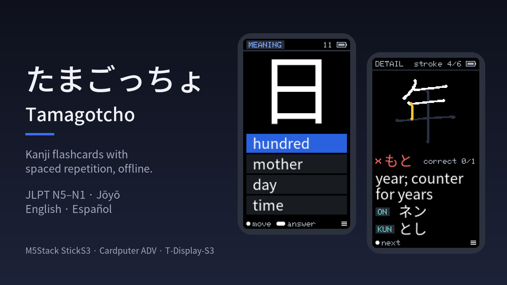
</p>

<h1 align="center">たまごっちょ · Tamagotcho</h1>

<p align="center">
  <b>A 電子単語帳 (<i>denshi tangochō</i>, electronic flashcard book) for kanji.</b><br>
  Multiple-choice reviews with spaced repetition on a wrist-sized ESP32.<br>
  Offline, two buttons, no app to install.
</p>

<p align="center">
  <a href="https://github.com/dcarnicer/tamagotcho/releases/latest"></a>
  <a href="https://github.com/dcarnicer/tamagotcho/actions/workflows/ci.yml"></a>
  <a href="LICENSE"></a>
  <a href="docs/data-sources.md"></a>
</p>

<p align="center">
  <a href="#install">Install</a> ·
  <a href="#first-start">First start</a> ·
  <a href="#how-to-use-it">How to use it</a> ·
  <a href="#decks">Decks</a> ·
  <a href="docs/user-guide.md">User guide</a> ·
  <a href="#build-it-yourself">Build it yourself</a>
</p>

---

A kanji appears; pick its meaning or its reading from four options and **hold
the button to answer**. Spaced repetition (FSRS) decides when you see it again,
and the wrong options are ones you could really confuse: kanji that look alike,
share a radical or sound the same. Get one wrong and a card shows everything
about it, with its **stroke order** drawn in front of you.

The name crosses Tamagotchi with *tangochō* (単語帳), the ring-bound vocabulary
cards Japanese students carry around, which the M5Stack StickS3 resembles.

## Screens

<table>
  <tr>
    <td align="center">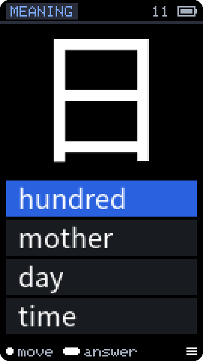<br><sub>Kanji → meaning</sub></td>
    <td align="center">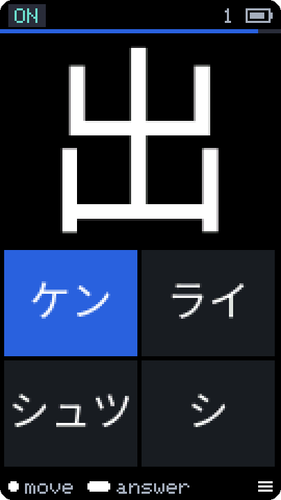<br><sub>Kanji → reading</sub></td>
    <td align="center">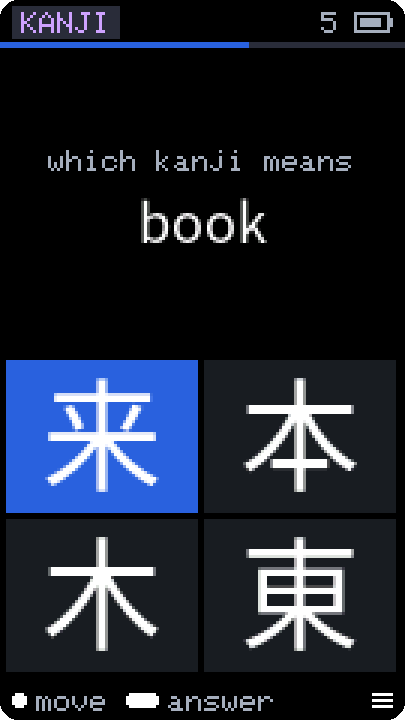<br><sub>Meaning → kanji</sub></td>
    <td align="center">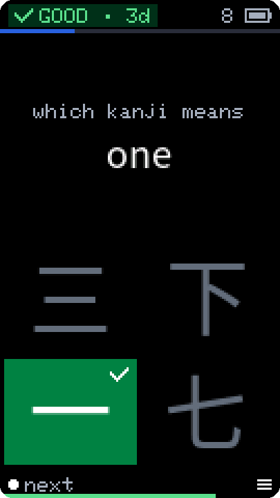<br><sub>Graded and scheduled</sub></td>
  </tr>
  <tr>
    <td align="center">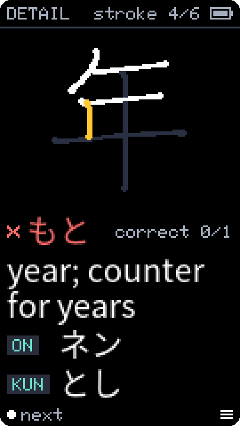<br><sub>Stroke order after a mistake</sub></td>
    <td align="center"><br><sub>Settings</sub></td>
    <td align="center">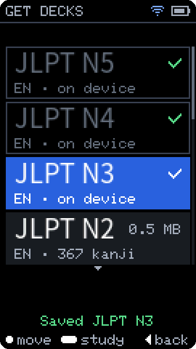<br><sub>Get decks over Wi-Fi</sub></td>
    <td align="center">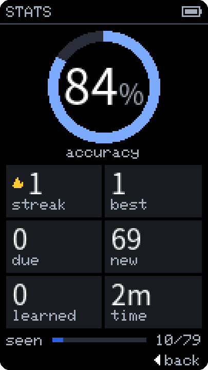<br><sub>Statistics</sub></td>
  </tr>
</table>

<p align="center">
  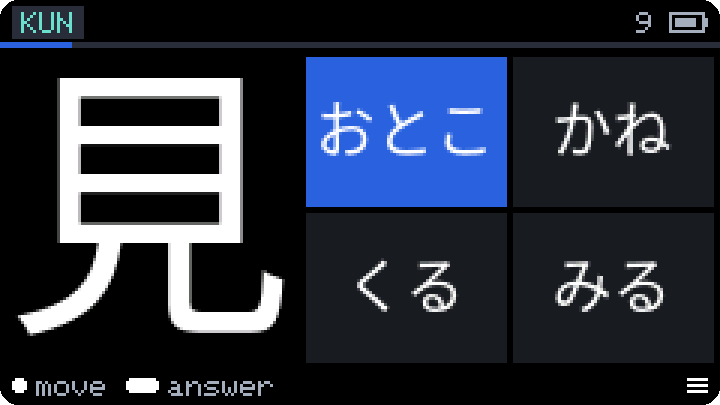
  &nbsp;
  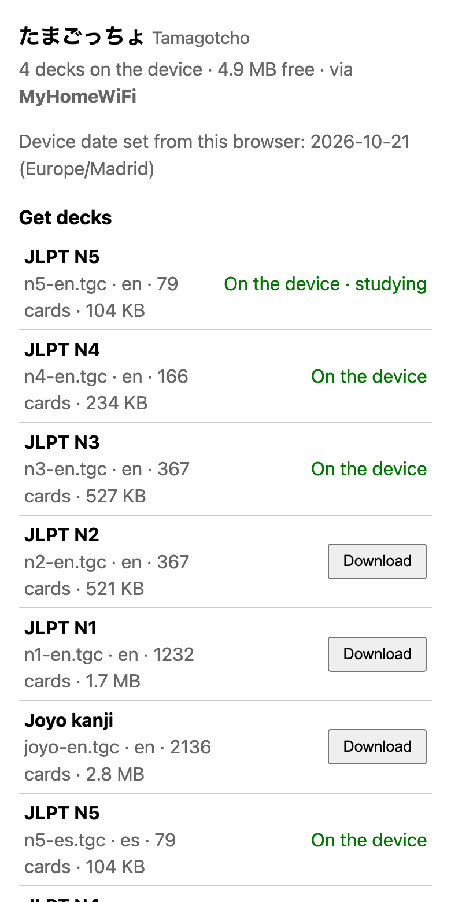
</p>
<p align="center"><sub>Landscape (the StickS3 turns the screen as you turn it) · the Wi-Fi portal on a phone</sub></p>

## Features

- **Three kinds of question**: kanji → meaning, kanji → reading (on'yomi or
  kun'yomi) and meaning → kanji, four options each. No wrong option is ever
  another valid answer.
- **Spaced repetition on the device** (FSRS-5): due cards first, a daily cap
  of new cards per deck, "+10 new" when you are done for the day. A right
  answer counts as Good, a slow one as Hard, a wrong one as Again.
- **A card for every mistake**: all meanings and readings, your accuracy on
  that kanji, and its stroke order animated from KanjiVG.
- **12 ready-made decks**: JLPT N5 to N1 and all 2,136 Jōyō kanji, in English
  and Spanish, downloaded over Wi-Fi from the device itself or from your phone.
- **Deck updates on their own**: with a home Wi-Fi saved, the device checks the
  catalog at boot (daily on USB power, weekly on battery) and shows "N
  updates"; a hold replaces a deck and keeps its progress.
- **Useful first**: readings ordered by the Jōyō table and everyday words,
  meanings by the words you will meet; on'yomi in katakana or hiragana.
- **Wi-Fi only when you want it**: a web portal on your home network (decks,
  statistics, uploads) or the device's own access point for the first setup,
  with QR codes on the screen. The radio is off the rest of the time.
- **Knows the date**: from your phone's clock or NTP, with the study day
  rolling over at 04:00 local, as in Anki, daylight saving included.
- **Kind to the battery**: dims after 30 s, deep-sleeps after 2 min and wakes
  where you left off.
- **Portrait, landscape or auto-rotate** (the StickS3's accelerometer);
  screens in English or Spanish.
- **Your own decks**: a Python pack builder for any JLPT level or school
  grade, your own kanji list, your WaniKani kanji, another font.

## Supported boards

| | Board | Screen | Input | Firmware files |
|---|---|---|---|---|
| 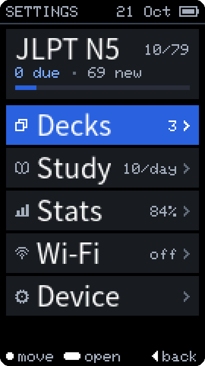 | [M5Stack StickS3](https://docs.m5stack.com/en/core/StickS3) | 1.14″, 135×240 | two buttons, auto-rotate | `tamagotcho-m5stack-*.bin` or `tamagotcho-sticks3-*.bin` |
| 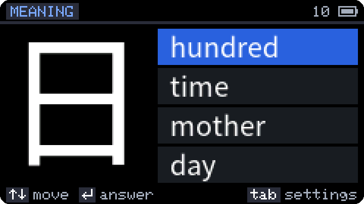 | [M5Stack Cardputer ADV](https://docs.m5stack.com/en/core/Cardputer-Adv) | 1.14″, 240×135 | keyboard | `tamagotcho-m5stack-*.bin` or `tamagotcho-cardputer-adv-*.bin` |
| 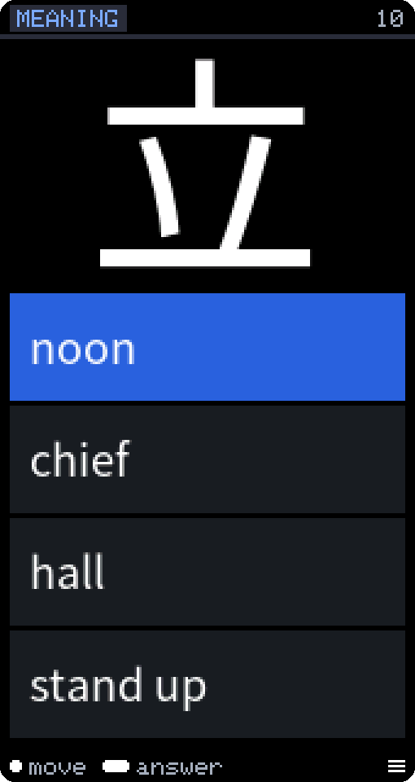 | [LilyGO T-Display-S3](https://lilygo.cc/products/t-display-s3) | 1.9″, 170×320 | two buttons | `tamagotcho-tdisplay-s3-*.bin` |

## Install

Every [release](https://github.com/dcarnicer/tamagotcho/releases/latest) has,
per board, a **merged** image (`*-merged.bin`, the whole flash from `0x0`) and
an **app-only** image (`*.bin`, for updates). The `m5stack` ones run on the
StickS3 and the Cardputer ADV alike: the firmware finds the board at boot.

**M5Burner** (StickS3 and Cardputer ADV). In [M5Burner](https://burner.m5stack.com/)
(on the web in Chrome or Edge, or the desktop app), search for **Tamagotcho**,
connect the device over USB and press **Burn**. One entry serves both boards.

**From the browser, first install** (Chrome or Edge on a computer). Open the
[install page](https://dcarnicer.github.io/tamagotcho/), pick the board and
press **Connect**, then **Install**. No download or esptool is needed. It writes
the merged image, so it is a **first install only**: the settings (home Wi-Fi,
preferences) are erased; decks and study progress stay. For an update use the
app-only image below or the release page. The page is published by
`.github/workflows/pages.yml` after each release.

**With Espressif's web flasher** (Chrome or Edge on a computer). Open
[esptool-js](https://espressif.github.io/esptool-js/), press **Connect** and
pick the device's port, add the board's `tamagotcho-<board>-merged.bin` at
address `0x0` and press **Program**.

**With esptool**:

```sh
esptool --chip esp32s3 write_flash 0x0 tamagotcho-sticks3-merged.bin     # a new device
esptool --chip esp32s3 write_flash 0x10000 tamagotcho-sticks3.bin        # update, keep the settings
```

A merged image erases the settings (home Wi-Fi, preferences); the decks and
the study progress live in their own partition and stay, unless the flash was
erased first. Details, and M5Launcher: [Flashing](docs/user-guide.md#flashing).

## First start

1. Pick the **language** of the screens: English or Español (a tap moves, a
   hold chooses).
2. A device without decks opens its own Wi-Fi, `Tamagotcho-XXXX`. Scan the
   **QR code** on the screen with your phone, open the page, enter your home
   Wi-Fi and press **Switch to my Wi-Fi**; then scan the new QR code.
3. **Download** a deck on the page, for example JLPT N5 in your language.
4. Press the side button and study.

From then on **Settings → Decks → Get decks** downloads decks without the
phone, and **Settings → Wi-Fi → Web portal** opens the page again. All the
details: [the user guide](docs/user-guide.md#getting-decks-onto-the-device-wi-fi-portal).

## How to use it

| | StickS3, T-Display-S3 | Cardputer ADV |
|---|---|---|
| Next option | tap the front button | `.` or an arrow |
| Previous option | tap the side button | `;` or an arrow |
| **Answer** | **hold the front button** (the option fills up) | Enter |
| After a wrong answer | tap: the card with the stroke order | `.` |
| Settings | hold the side button | Tab |
| Back | the side button | Esc |

After a right answer the next card comes by itself. In every menu a tap
moves, a hold opens or chooses, and the bar at the bottom says what each
button does. The settings are in five groups: **Decks**, **Study** (new cards
per day, when an answer counts as slow, auto-advance, on'yomi in hiragana,
delete progress), **Stats**, **Wi-Fi** and **Device** (orientation,
brightness, language, hold time, date and time zone, sleep, About). Every
control: [firmware/README.md](firmware/README.md#controls).

## Decks

The prebuilt decks are in the [`decks-v2`](https://github.com/dcarnicer/tamagotcho/releases/tag/decks-v2)
release, which the device's **Get decks** and the portal page read:

| Deck | Kanji | English | Spanish |
|---|---:|---|---|
| JLPT N5 | 79 | `n5-en` | `n5-es` |
| JLPT N4 | 166 | `n4-en` | `n4-es` |
| JLPT N3 | 367 | `n3-en` | `n3-es` |
| JLPT N2 | 367 | `n2-en` | `n2-es` |
| JLPT N1 | 1,232 | `n1-en` | `n1-es` |
| Jōyō kanji (school order) | 2,136 | `joyo-en` | `joyo-es` |

Progress belongs to each kanji, so decks that share one share its progress.
The decks contain KANJIDIC2 and KanjiVG data and are licensed **CC BY-SA**
([data sources](docs/data-sources.md)).

## Build it yourself

```sh
cd firmware
pio test -e native                    # the pure logic, on your computer
pio run -e sticks3 -t upload          # or -e tdisplay-s3, -e cardputer-adv

cd tools/pack-builder                 # a deck of your own
uv run tamagotcho-pack build --jlpt 5 --lang en --strokes -o out/n5-en.tgc
```

Upload a `.tgc` from the portal page (**Advanced**). More:
[firmware/README.md](firmware/README.md) and
[tools/pack-builder/README.md](tools/pack-builder/README.md).

## Documentation

| | |
|---|---|
| [User guide](docs/user-guide.md) | the Wi-Fi portal, flashing, M5Launcher, decks, releases |
| [Firmware](firmware/README.md) | build, flash layout, controls, power, date |
| [Pack builder](tools/pack-builder/README.md) | building decks |
| [Architecture](docs/architecture.md) · [Pack format](docs/pack-format.md) · [SRS](docs/srs.md) | how it works inside |
| [Roadmap](docs/roadmap.md) · [Decisions](docs/decisions.md) | what is done, what is next, and why |
| [Screenshots](tools/screenshots/README.md) | the serial remote that took the pictures above |

## Repository layout

| path                  | what                                    |
|-----------------------|-----------------------------------------|
| `firmware/`           | PlatformIO firmware (StickS3, T-Display-S3, Cardputer ADV) |
| `tools/pack-builder/` | Python CLI that builds `.tgc` packs     |
| `tools/release/`      | release helper: merge a build into one flashable image |
| `tools/ui-font/`      | generator of the firmware's UI font (`firmware/src/ui/UiFont.h`) |
| `tools/screenshots/`  | serial remote: press a device's buttons and save its screen over USB (`-shots` builds) |
| `.github/workflows/`  | CI, firmware release and decks release automation |
| `docs/`               | user guide, architecture, pack format, decisions, roadmap |

## Licence

Code: MIT. Generated packs contain data from KANJIDIC2 (© EDRDG, CC BY-SA 4.0)
and, with stroke order, KanjiVG (© Ulrich Apel, CC BY-SA 3.0), and glyphs from
the selected font (default Noto Sans JP, © Adobe, SIL OFL 1.1). The firmware
embeds its own UI font, glyphs pre-rendered from Noto Sans JP (© Adobe, SIL
OFL 1.1; `firmware/src/ui/UiFont.h`, generated by `tools/ui-font/`). See
[docs/data-sources.md](docs/data-sources.md). On the device, **Settings ›
Device › About** shows the firmware version and licence, the decks' licence,
the UI font and the data credits (KANJIDIC2, KanjiVG, the JLPT level lists,
Noto Sans JP), and the Wi-Fi portal page repeats them in its footer.
