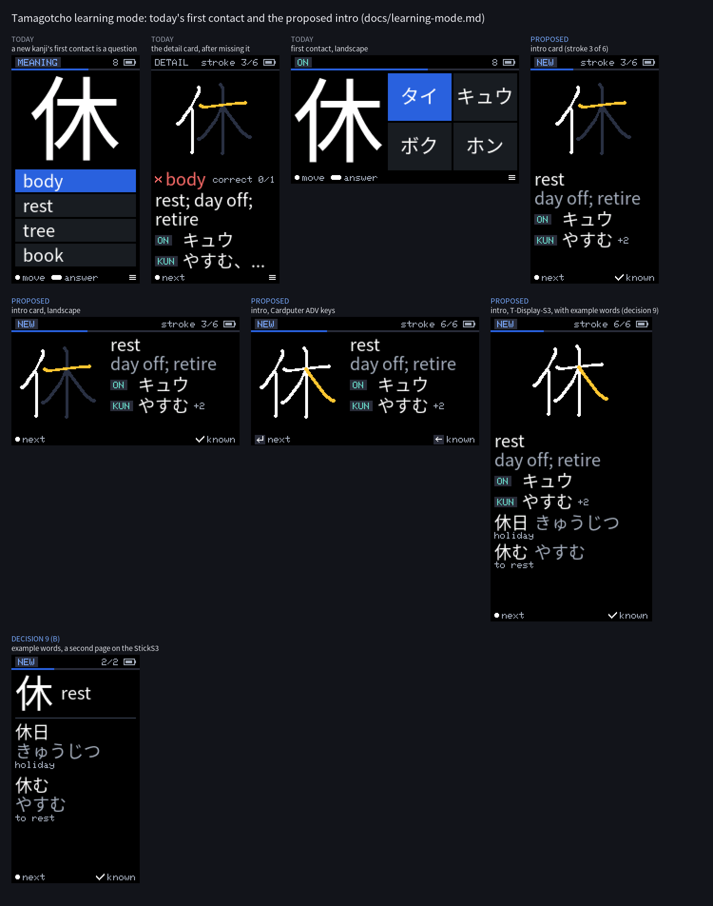
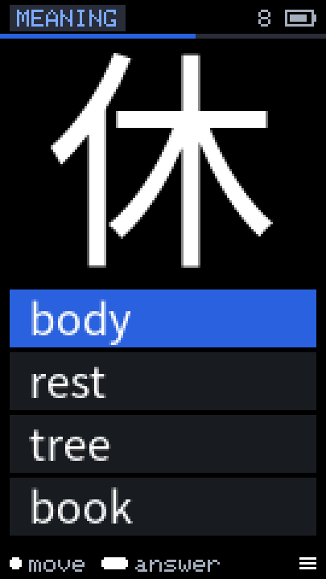
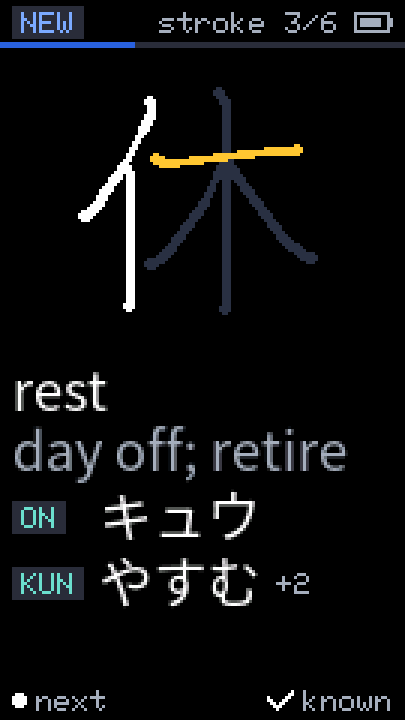
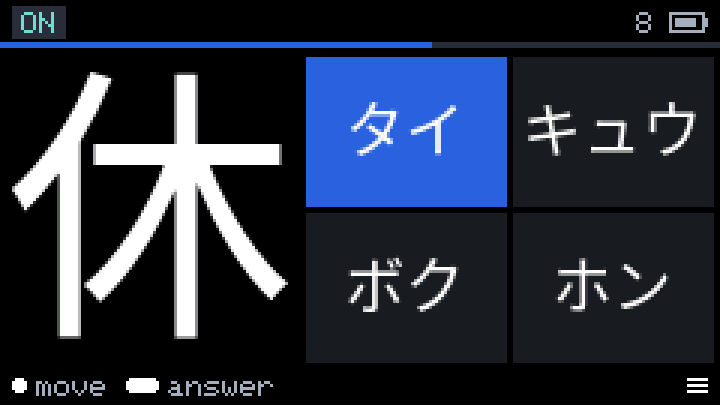
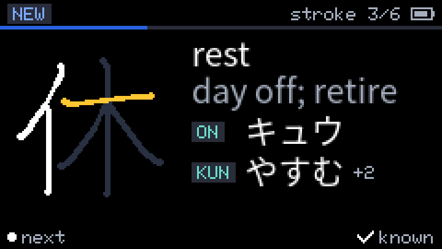
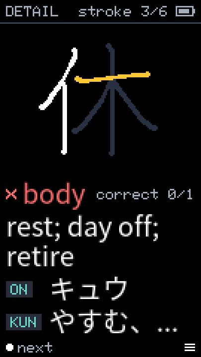
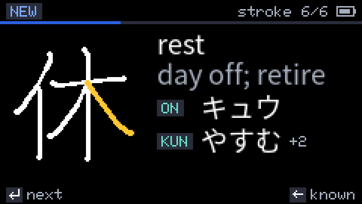
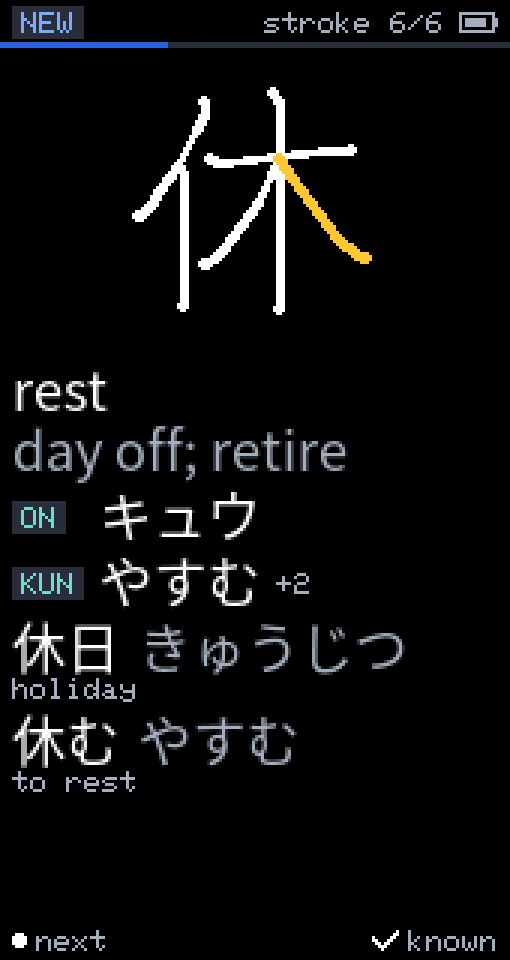
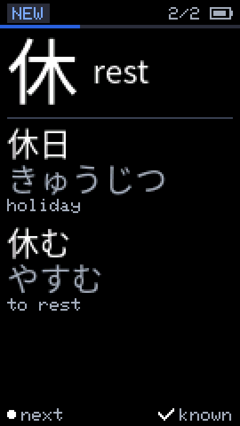

# Learning mode: design and open decisions

> **Status: approved (2026-10-23).** The maintainer accepted every
> recommendation of §6 as written, so §3 is the design to build. Phases 1-3 of
> §5 are being implemented. Decision 9 was revisited after the measurement in
> docs/example-words.md: phase 4 (example words) is approved with glosses in
> both languages (see §6).

The roadmap entry "Learning mode (idea, 2026-10-18)" asks for a mode for
*learning* kanji, not only reviewing them: for example, introducing a new
kanji (meanings, readings, stroke order) before its first multiple-choice
question. Today the app only quizzes: a new card's first contact is already a
four-option question about a kanji the learner has never been shown.

This document covers: how a new card is handled today, from the queue to its
first FSRS rating (§1); what "learning" could mean on these devices (§2); a
recommended design (§3); mockups (§4); a phased implementation plan (§5);
and the decisions the maintainer has to take, numbered, each with options,
trade-offs and a recommendation (§6).



**Mockups.** `docs/learning-mode/*.png` are at native resolution and the
`@3x` files are nearest-neighbour upscales; `overview.png` is the contact
sheet. They are generated by `tools/ux-mockups/learning.py`, a sibling of the
UX refresh's `render.py` that reuses its canvas, glyph and KanjiVG helpers but
draws the style the firmware has now (flat, the Noto Sans JP UI font, the
geometry of `quizGeom()` and `render/Widgets.cpp`); `render.py`'s own "after"
images predate the answers in docs/ux-refresh.md §6.

```sh
cd tools/pack-builder && uv run python ../ux-mockups/learning.py   # [--cache DIR] [--out DIR]
```

It needs the builder cache (`noto/NotoSansJP-Regular.otf` and the KanjiVG
zip, from `uv run tamagotcho-pack fetch`), and its output is deterministic. The
"before" images were checked against the device screenshots in `docs/images/`
(`quiz-meaning.png`, `detail.png`). The sample card is 休 (rest) with its
KANJIDIC2 data; the example words of decision 9 are JMdict's.

---

## 1. How a new card is learned today

### 1.1 From the queue to the first rating

1. **Queue.** `Queue::rebuild()` (`srs/Queue.cpp`) classifies the loaded
   deck's cards by their SRS record: no record, or `due_day == 0`, is *new*.
   Reviews come first (most overdue, then weakest), then new cards in the
   pack's `level` order, at most `new_per_day` + the "+10 new" extra minus the
   deck's cards introduced today (`introducedOn()` in `srs/SrsStore.h`: record
   flag bit0 with `last_day == today`, docs/decisions.md 2026-10-18 "New-card
   cap per deck"). The session holds at most 200 items. `main.cpp` rebuilds
   the queue at boot, on a deck change, after the date screen or a date sync,
   when New per day changes, after a restore or a reset, and for "+10 new"
   (thirteen call sites).
2. **Mode.** `Queue::next()` calls `chooseMode()`: the mode with the fewest
   uses in the record's `mode_seen` bits, ties broken toward a mode other than
   the previous item's. A new card has no bits set, so its first question is
   simply the next askable mode after the previous item's in the ring
   Meaning → Reading → Meaning→Kanji: about a third each.
3. **Question.** `newQuestion()` (`main.cpp`) builds it with `buildQuestion()`
   (`quiz/Quiz.cpp`), trying the item's mode and then the other two. A meaning
   question asks the card's **first** meaning (`kOptionMeanings = 1`); a
   reading question asks the **first** reading of the kind `ReadingTurn` wants
   (on'yomi and kun'yomi alternate); meaning → kanji shows the first meaning
   and four visually similar kanji. `drawQuiz()` shows the mode pill
   (`MEANING`, `ON`, `KUN`, `KANJI`), the cards left and the session bar;
   nothing says that this kanji is new.
4. **Answer.** `holdAction()` grades: a wrong pick is Again; a right one is Hard
   when it took at least `slow_ms` (3 s, minus 400 ms per navigation tap), else
   Good. `SrsStore::grade()` sees `reps == 0` and calls `initMemory(g)` (FSRS-5:
   `S0 = w[G-1]`, `D0 = w[4] - exp(w[5]·(G-1)) + 1`), sets the due day to today
   + `round(S)`, flag bit0 ("introduced on `last_day`"), `reps = 1`, `lapses`,
   `mode_seen`, `last_grade`, and counts the answer: `answered_total`,
   `again_total`, the day streak, `review_ms`. `Queue::answered()` re-inserts an
   Again card 5 items ahead (at most 3 times a session).
5. **Feedback.** `afterReveal()`: after a right answer the auto-advance moves
   on (1 s by default); after a wrong one `showDetail()` opens the **mistake
   detail card**: the kanji animating its stroke order from KanjiVG (strokes
   written so far in `text`, the current one in `warn`, the rest as a `ghost`;
   550 ms a stroke, 1.2 s on the last, then again), what was picked, the
   card's accuracy ("correct 0/1"), every meaning (up to three lines) and every
   reading behind `ON`/`KUN` pills. Any press goes on.
6. **Relearn.** Five items later the missed card is asked again. Same day,
   so FSRS-5's short-term formula applies, `S' = S·exp(w[17]·(G − 3 + w[18]))`:
   ×1.41 for Good, ×0.84 for Hard, ×0.50 for Again. 0.40 d becomes 0.56 d, and
   the card is due tomorrow.

What a never-seen kanji gets from its first answer:

| first answer | S0 | D0 | next due | also counted |
|---|---|---|---|---|
| wrong (Again) | 0.40 d | 7.19 | tomorrow (0.56 d after a right relearn) | an answer, an Again, `lapses = 1`: lifetime accuracy, "correct 0/1" |
| right, slow (Hard) | 1.18 d | 6.49 | tomorrow | an answer |
| right, fast (Good) | 3.17 d | 5.28 | in 3 days | an answer |

### 1.2 Problems

- **L1 – The first contact is a test of something never shown.** A beginner
  can only guess. The kanji is taught by the detail card, which appears only
  after a miss and only for as long as the learner looks at it before
  pressing on.
- **L2 – A lucky guess schedules an unknown kanji for three days.** Four
  options give a blind guess a 25 % chance (more with elimination), and a fast
  right guess is Good: `S0 = 3.17` d, next due in 3 days, never shown the
  detail card. The meaning → kanji mode makes it worse: the four options are
  the most similar-looking kanji of the deck, none of which was shown.
- **L3 – The forced miss is counted as a failure.** A miss on first contact
  adds to `again_total` (the lifetime accuracy on the stats screen, the
  settings home and the portal), sets `lapses = 1` (the detail card's
  "correct 0/1", the portal's weakest kanji once `reps ≥ 3`), and raises D.
- **L4 – The first rating's difficulty is nearly permanent.** Without an Easy
  grade, a Good leaves D unchanged (`ΔD = −w[6]·(G − 3) = 0`) and the mean
  reversion toward `D0(Easy) = 3.22` is `w[7] = 0.46 %` a review. So whatever
  D the first answer sets, 7.19 after a miss or 5.28 after a lucky guess, stays
  for good, and with it how fast the intervals grow (§3.5 table: the fifth
  interval is 36 days after a first miss, 261 after a first Good).
- **L5 – The first question's kind is arbitrary.** By the rotation it is as
  likely a kun'yomi or a meaning → kanji question as the easier kanji →
  meaning.

### 1.3 What a pack carries

What an intro card could show without a pack-format change
(docs/pack-format.md):

| data | in the pack | shown today | for an intro |
|---|---|---|---|
| meanings | up to 3, `; `-separated, the first is the one asked (`--meaning-order` puts the most useful first) | quiz (first only), detail card (all) | all, the first emphasised |
| readings | on'yomi (katakana) and kun'yomi (hiragana, `.` okurigana), most useful first, a kind may be empty (`--common-readings`); every listed reading is a valid answer | quiz (first of a kind), detail card (all) | all, the first of each kind emphasised |
| stroke order | optional section of KanjiVG masks per stroke (`--strokes`; every published deck has it, `decks.yml`) | detail card animation | the same animation |
| stroke count, JLPT level, school grade, frequency, `level` | card table | stroke count on the detail card | stroke count in the header; the rest is not worth the room (decision 2) |
| example words, components, mnemonics, audio | **not in packs** | – | example words: §3.11 and decision 9 |

---

## 2. What "learning" could mean here

The hardware sets the limits:

| board | panel | input | notes |
|---|---|---|---|
| M5Stack StickS3 | 135×240, portrait or landscape (Auto with the IMU) | front button (tap, hold), side button (tap, hold) | primary; a speaker, unused |
| LilyGO T-Display-S3 | 170×320 | two buttons | room for more text in portrait |
| M5Stack Cardputer ADV | 240×135, landscape only | keyboard (arrows, Enter, Esc, Tab), G0 | `keyAction()` maps keys to the buttons' actions |

No touch screen and no pen: **stroke tracing or handwriting is impossible**.
Options, with how well they fit:

- **O1 – Introduction card.** Before a new kanji's first question, a card shows
  it: the stroke animation, the meanings and readings, the ones the quiz asks
  emphasised. Cheap: the detail card already draws all of it from data every
  published deck has. Fixes L1, L2 (no new card is asked cold) and L3 (no
  forced miss); with the steps below L5, and with what it records in FSRS
  (§3.5) L4.
- **O2 – Learning steps (Anki).** After the intro, the card is asked a few
  times in the same session at short gaps, then graduates to day intervals.
  FSRS-5 already models same-day reviews (`w[17]`, `w[18]`) and the queue
  already re-inserts cards (the relearn path), so this is a small queue
  change. Gives retrieval practice minutes after the exposure.
- **O3 – Recognition before recall.** Choose the steps' question kinds from
  easy to hard: kanji → meaning (recognise the kanji), then the reading (the
  harder half, shown on the intro), and meaning → kanji (discriminate among
  similar kanji) only from the next day, where the rotation puts it anyway.
- **O4 – Lessons in batches (WaniKani).** A separate flow: a "learn" screen
  shows a batch of five intros, then quizzes the batch; reviews start later.
  A second mode next to the daily session, with its own entry point and
  state. O1 + O2 with a gap of three items gives batches of four inside the
  normal session anyway (§3.4).
- **O5 – Example words.** One or two common words per kanji (休日 きゅうじつ
  "holiday") show the readings in use. Needs data packs do not carry, glyphs
  for the words' other kanji and Spanish glosses: a pack-format change
  (§3.11, decision 9).
- **O6 – Components and mnemonics.** KanjiVG marks each kanji's components
  (休 = 亻 + 木), so "made of" lines are possible later (more pack data and
  glyphs). No openly licensed mnemonic source exists (WaniKani's are © Tofugu;
  the optional importer does not take them). Not proposed.
- **O7 – Stroke-order exercises.** Without touch, only multiple choice: "how
  many strokes?" or "which stroke comes next?" (a half-drawn kanji and four
  highlighted candidate strokes, from the stroke masks). Possible later; it
  tests stroke order, which the quiz does not grade. Not proposed now.
- **O8 – Audio.** The StickS3 has a speaker, but there is no openly licensed
  per-reading audio and no room for TTS. Not proposed.

**Recommended:** O1 + O2 + O3 inside the daily session; O5 later, after its
data question is answered; the rest not now.

---

## 3. Recommended design

### 3.1 Flow

```
queue item: a never-seen kanji (no record), learning mode on
  │
  ▼
intro card (Screen::Intro) ── side tap "known" ──► asked at once, as today: a normal
  │                                                first answer (initMemory), no steps
  │ front tap / hold
  ▼
SrsStore::introduce(): a record with S 0.40 d, D 5.28, due today,
flags "introduced today" + "learning"; nothing counted as an answer
  │
  ▼  3 items later
step 1: kanji → meaning, graded as a same-day review (w[17], w[18])
  │      (wrong: the detail card, and the usual relearn 5 items later)
  ▼  3 items later
step 2: reading (the kind ReadingTurn wants)
  │
  ▼
tomorrow: an ordinary review; the rotation picks meaning → kanji next
```

Learning mode off (decision 7) is today's behaviour exactly: no intro items,
no steps, the first answer is the first rating.

### 3.2 The intro card

A sibling of the detail card (portrait: [intro-after](learning-mode/intro-after@3x.png),
landscape: [intro-landscape-after](learning-mode/intro-landscape-after@3x.png)):

- **Header.** A `NEW` / `NUEVA` pill (`accent-hi` on `surface-hi`, like the
  quiz's mode pills), the stroke counter on the right as on the detail card
  (`stroke 3/6`, the bare `3/6` when the worded counter of the last stroke does
  not fit, `strokes 6` without stroke data; `strokeCounterWorded()`), the
  battery, and the quiz's 2 px session bar, so the session's progress stays in
  view. Budget: `NEW` leaves 79 px for the counter in the 135 px portrait
  (`stroke 13/15` is 72 px); Spanish `NUEVA` leaves 67 px (`trazo 13/15` is
  66 px), so the worded counter fits up to 29 strokes in both languages.
- **Kanji.** The quiz's prompt box with the detail card's stroke animation,
  from the first stroke; the static glyph when the pack has no stroke data.
- **Meanings.** The first (the one the quiz asks) on its own line in `text`;
  the others on the next line in `text-dim`, cut with "..." (the UI font, 18
  px).
- **Readings.** One row per kind the card has, behind `ON` / `KUN` pills as on
  the detail card: the first reading (the one the quiz asks) in `text`, then
  the others in `text-dim` after "、" when they all fit, else a `+2` caption
  (休: `やすむ +2`). On'yomi in the script of Settings › Study › On'yomi
  (decision 3).
- **Nothing else.** No pick line and no accuracy (there is no answer yet), no
  JLPT level or grade (the deck already says it), no example words (decision 9).
  In the 135 px portrait the column ends at y 206, 22 px above the hint bar;
  the 240 px landscape's right column holds the same rows.
- **Hint bar, always shown** (unlike the quiz's policy: this screen's side tap
  means something new): `• next` on the left and `✓ known` on the right
  (Spanish `• siguiente` and `✓ la sé`: 66 px of front items and the side
  group from x 89 in the 135 px portrait, one row). On the Cardputer ADV:
  `↵ next` and `← known` ([intro-cardputer-after](learning-mode/intro-cardputer-after@3x.png)).

### 3.3 Controls

| action | StickS3, T-Display-S3 | Cardputer ADV |
|---|---|---|
| done reading: go on (the card enters its steps) | front tap or hold | Enter, → or ↓, G0 |
| "I know this one": ask it now instead | side tap | ← or ↑ |
| settings home | side hold | Tab, Esc |

- **Why "known" is on the side tap** (decision 4): the detail card, which
  looks alike, takes any front press (and Enter) as "next", so the intro
  keeps that and puts the new action on the button the quiz uses for its
  second action (the previous option). A side tap pressed by habit only asks
  the card at once, which is today's behaviour.
- **Guard.** A press that goes down in the intro's first 400 ms is ignored, so
  a double tap on the previous screen cannot skip it (the Delete progress
  confirmation has the same kind of guard for Enter, `kConfirmGuardMs`).
- **No auto-advance**, no hold fill (nothing to fill; the done screen and the
  date stepper have holds without one). The panel dims after 30 s and sleeps
  after 2 min as everywhere; the animation pauses while dim, as on the detail
  card.
- **Sleep, settings, deck change.** `introduce()` runs when the learner goes
  on, not when the card is drawn: an intro left by a sleep, a deck change or a
  rebuild was never recorded, and the card is still new, so it is introduced
  again. The side hold opens the settings and closing them returns to the
  intro (`gBeforeMenu`).

### 3.4 Learning steps and their order

- When the learner goes on from an intro, the queue inserts **step 1**
  (kanji → meaning) 3 items after the cursor; when step 1 is answered,
  **step 2** (a reading question, on or kun by `ReadingTurn`) 3 items after
  that, whatever step 1's grade. An Again in a step also gets the existing
  relearn (5 items ahead, at most 3 a session) and the detail card. A step
  whose mode the card cannot be asked (no meaning, no reading) falls back as
  `newQuestion()` does now.
- A gap of 3 turns the new cards at the end of the session into **batches of
  four**, without a separate lesson mode. Ten new cards (`I` intro, `M` step
  1, `R` step 2):

  ```
  I A, I B, I C, I D, M A, M B, M C, M D, R A, R B, R C, R D,
  I E, I F, I G, I H, M E, M F, M G, M H, R E, R F, R G, R H,
  I I, I J, M I, M J, R I, R J
  ```

  With fewer than 3 items left, a step goes to the end (the last card's step
  then follows its intro directly).
- **"Known"** inserts the card as an ordinary item at the cursor: asked at
  once, graded as a first answer (`initMemory`), no steps, as today.
- **Reviews still come first** and new cards after them (decision 10).
- Steps live in the queue only. A rebuild (a new day, a deck change, "+10 new",
  a date sync, a settings change) drops pending steps; the card's learning
  record is then an ordinary due card and is asked once, as a review.
- `Queue::remaining()` counts the steps the intros still to come will add, so
  the header's count of cards left does not jump up after each intro; an
  intro counts as a done item in the session bar.

### 3.5 FSRS and the state file

**What the intro records** (decision 6): an exposure, not an answer. FSRS-5 has
no "seen but not rated" event; the design takes the stability of a first
exposure that was not recalled (`w[0]`, the Again stability, 0.40 d) and the
difficulty of a card with no evidence against it (`D0(Good)` = 5.28), and lets
the steps' answers move both the FSRS way: a same-day Good ×1.41, an Again
×0.50 and `D + 1.5`.

`SrsStore::introduce(codepoint, day)` (new) writes, in the record's existing
16 bytes:

| field | value | note |
|---|---|---|
| `stability_cds` | 40 | `w[0]` = 0.40 d |
| `difficulty10` | 53 | `D0(Good)` = 5.28 |
| `due_day`, `last_day` | today | due now; the steps are in the queue |
| `reps`, `lapses` | 0 | not an answer: accuracy and "correct x/y" untouched |
| `mode_seen`, `last_grade` | 0, 0xFF | |
| `flags` | bit0 + **bit1** | bit0 "introduced on `last_day`" (the cap counts it), bit1 **"learning"**: introduced, never answered (new) |

- `grade()`: `first = reps == 0 && !learning`. A learning record is graded with
  `nextMemory()` from its S and D, `elapsed = day − last_day` (0 the same day:
  the short-term formula); the grade clears bit1, and bit0 follows today's rule
  (kept on the intro day, cleared on a later one). A card already reviewed is
  never introduced, so nothing else changes.
- **Queue and counts.** A learning record is classified as **due**, whatever
  its `due_day` (on SRS day 0, `due_day == 0` would otherwise read as new),
  and `deckSummary()` counts it as seen, not fresh. `SrsStore::stats()` counts
  it as seen. `introduce()` also bumps the legacy header counter
  `new_introduced_*` as a first grade does.
- **Not counted:** `answered_total`, `again_total`, the streak (the steps that
  follow are answers and count as today). `review_ms` gets the intro's time,
  capped at 30 s (decision 8).
- **File.** Same layout, same size: bit1 of the record's `flags` was always 0.
  No version bump; backup and restore, Delete progress and deck deletion work
  on it unchanged (a forgotten learning record makes the kanji new again).

**Schedules** (every later review answered Good on its due day, fuzz at its
centre; from the firmware's formulas and rounding):

| path | S after day 0 | D | next five intervals (days) | reviews in the first year |
|---|---|---|---|---|
| today, first answer right and fast (known, or a lucky guess) | 3.17 | 5.3 | 3, 11, 34, 98, 261 | 4 |
| today, first answer wrong, relearn right | 0.56 | 7.2 | 1, 2, 6, 15, 36 | 7 |
| **proposed (C)**: intro, steps 1 and 2 right | 0.79 | 5.3 | 1, 4, 13, 41, 116 | 5 |
| proposed (C): intro, step 1 wrong, relearn and step 2 right | 0.39 | 6.8 | 1, 2, 6, 17, 42 | 6 |
| alternative (B, intro = Again): intro, steps right | 0.79 | 7.2 | 1, 3, 8, 20, 46 | 6 |
| alternative (A, intro not in FSRS): step 1 is the first rating, both right | 4.46 | 5.3 | 4, 14, 43, 122, 320 | 4 |
| alternative (D, intro = Hard): intro, steps right | 2.34 | 6.5 | 2, 6, 17, 45, 110 | 5 |
| "known": asked at once, right and fast | 3.17 | 5.3 | 3, 11, 34, 98, 261 | 4 |

The last column counts the reviews after day 0 within 365 days. Every
introduced card comes back tomorrow under C, so the first real test is always
a day later; how fast it then grows is decided by the answers (a step miss
lands it near today's "missed" curve), not by the intro. The options differ by
about one review per card in the first year and more after it, as the
intervals drift apart (the fifth is 46 days under B, 116 under C).

### 3.6 Daily new-card cap and "+10 new"

The intro *is* the introduction: `introduce()` sets bit0 with `last_day =
today`, so `Queue::rebuild()` counts the card against the deck's
`new_per_day` from the moment it was shown, steps or no steps. "+10 new"
(`studyMoreExtra()`) brings ten more intros. New per day keeps its values and
default (10): each new card is now about three screens (the intro and two
steps), where today it is one (a right first answer) or three (a miss: the
question, the detail card, the relearn).

### 3.7 Session, auto-advance, hint bar

- The quiz is unchanged for the steps: the same header, tiles, grading
  (Hard after, the navigation allowance), auto-advance after a right answer,
  the detail card after a wrong one, the hint bar policy (first 50 answers,
  then after 8 s idle).
- The intro never auto-advances and always shows its hint bar (§3.2).
- The done screen is unchanged; "+10 new" shows while the deck has never-seen
  cards (`deckSummary().fresh`), which learning records are not.

### 3.8 Settings

**Study › Introduce** (`Presentar`), values **On** (default) / **Off**, a
picker like Auto next (decision 7). Global, NVS `tangocho`/`intro`. The label
and values fit a Study row (107 px in portrait); `test_settings` checks them.
Off gives today's flow; turning it off with learning records in the deck
leaves them as due cards (asked once as reviews).

### 3.9 Statistics and the portal

Intros are not answers: the accuracy, the answer count, the Again count and
the streak are as today, so they stop counting the forced first-contact miss
(L3). The "time" tile and `/api/stats` `reviewMs` include intro time (capped
at 30 s an intro). Seen counts introduced kanji; "new" counts never-seen ones.
The portal needs no change; a `learning` count in `/api/stats` is optional.

### 3.10 What the detail card gives and lacks

The intro is built from the detail card's parts; `drawDetail()` today reads
the current question (`gQ`) throughout, so the parts must be taken out of it
first:

| the detail card has | the intro needs |
|---|---|
| the kanji box and the stroke animation (`drawDetailKanji()`, `drawDetailFrame()`, the `Screen::Detail` branch of `handleInput()`), keyed to `gQ.cardIndex` | the same, keyed to a card index (no question exists yet) |
| the header with `DETAIL` and the stroke counter | the `NEW` pill, the counter, and the session bar |
| the pick line and "correct x/y" | nothing (no answer, no record) |
| all meanings, wrapped in `text` | the first in `text`, the rest in `text-dim` |
| reading rows (`detailReadings()` in `ui/QuizUi.h`), all readings in `text`, katakana always | the first of each kind in `text`, the rest dim or `+N`; on'yomi per the setting |
| the quiz's hint bar policy, `• next` | always shown, `• next` and `✓ known` |
| any press but the side hold goes on | front press goes on, side tap "known", a 400 ms guard |
| no example words, no metadata | the same (decision 9) |

### 3.11 Example words (decision 9, option b)

The measurement and the gloss sources are in
[docs/example-words.md](example-words.md); the Spanish glosses come from a
reviewed project table, not from JMdict (§6, decision 9 revisited).

If the maintainer wants them (mockups:
[T-Display-S3](learning-mode/intro-tdisplay-after@3x.png),
[StickS3 second page](learning-mode/intro-words-after@3x.png)):

- **Source.** The builder already reads, for `--common-readings`, JMdict's
  words and priority tags, JmdictFurigana (which reading each kanji has in a
  word), wordfreq and the JLPT vocabulary lists (docs/data-sources.md
  "Reading order"). The most common word that uses the card's asked on'yomi,
  and one for the asked kun'yomi, is a small step from there.
- **Licence.** Today a pack built with those inputs "contains no word data
  from them". Words would put JMdict data in the pack: CC BY-SA 4.0 under the
  same EDRDG licence and attribution as KANJIDIC2 ("This package uses the
  JMdict and KANJIDIC2 files…"), so packs stay CC BY-SA 4.0; the JLPT lists
  (CC BY), wordfreq (CC BY-SA 4.0) and Tatoeba (CC BY 2.0 FR, counts only)
  keep their credits. docs/data-sources.md, the About screen's credits
  (`Credits.h`) and the portal footer change with it.
- **Spanish glosses.** `JMdict_e` is English only. The full JMdict has
  Spanish glosses for part of its entries; how many of the words chosen for
  N5-N1 have one must be measured first. Machine-translating the English gloss
  through the FreeDict dictionary of `--meaning-order` would give wrong senses
  often. A word without a gloss in the deck's language could show its reading
  only.
- **Pack format (spec first, then both sides).** The header's 64 bytes and the
  card's 32 are all in use, so a words section needs a header extension and a
  version bump (v3) with a `words_off` (0 = none), a per-card index and the
  strings; set 2 must also hold the glyphs of the words' other kanji (18 px).
  Rough cost: +10–15 % for a Jōyō pack, to be measured. No backward
  compatibility is needed, but the firmware keeps reading v2 packs without
  words.
- **Display.** The 170 px T-Display-S3 portrait fits two words with readings
  and glosses under the readings. The 135 px panels do not: a word and its
  reading already take 132 px, so the words need a second page (a front tap
  turns to it, the next goes on: one more press per new card).

---

## 4. Mockups

| screen | today | proposed |
|---|---|---|
| a new kanji's first contact, portrait |  |  |
| the same, landscape |  |  |
| where the kanji is taught today: the detail card after a miss |  | – |
| Cardputer ADV keys (stroke 6 of 6) | – |  |
| T-Display-S3, with example words (decision 9 b) | – |  |
| StickS3, example words on a second page (decision 9 b) | – |  |

The steps after the intro are ordinary quiz screens and are not mocked.

---

## 5. Implementation plan

`firmware/src/main.cpp` is being split into modules on `refactor/split-main`,
so the firmware changes are named by screen and function, not by line. Each
phase builds and keeps every board working; phases 1 and 4 can start at once,
phase 2 once the split has landed.

**Phase 1 – SRS and queue (S–M, ~1 d; pure, native-tested; branch
`feature/learn-srs`).**
- `srs/SrsStore`: `kRecordFlagLearning` (bit1), `introduce(codepoint, day)`,
  `grade()` for a learning record, `isLearning()`.
- `srs/Queue`: item kinds (`Ask`, `Intro`, `Step`) and the step's mode in
  `QueueItem`; `setLearning(LearnOptions{on, steps, gap})`, set once at boot
  and on the setting's change, so the thirteen `rebuild()` call sites stay as
  they are; `introduced(cardIndex)` (insert step 1), `known(cardIndex)` (ask it
  now), step insertion in `answered()`; learning records classified as due;
  `remaining()` with the steps still to come.
- `ui/DeckSummary.h`: a learning record is seen, not fresh.
- docs/srs.md: §2 (the flags), §6 (the queue), §7.
- Native tests (`test_srs`, `test_settings`): `introduce()` writes S 0.40,
  D 5.28, due today, bits 0 and 1, and leaves answers, Again, streak and
  `lapses` alone; a Good the same day gives S 0.56 and clears bit1; a grade on
  a later day uses the regular formula and clears bit0; the cap counts an
  introduced card; a learning record is due on day 0 and after a rebuild; the
  file round-trips the flag; `forget()` makes the kanji new again; the queue
  with learning off is item for item today's; intros only for never-seen
  cards; step 1 and step 2 land 3 items on, with their modes; the batches of
  §3.4 for ten new cards; an Again in a step relearns and step 2 still comes;
  "known" asks at once with no steps; `remaining()` does not jump; "+10 new"
  gives intros; the session cap.

**Phase 2 – The intro screen (M, ~2 d; after `refactor/split-main`; branch
`feature/learn-intro`).**
- Take the detail card's kanji box, stroke animation and reading rows out of
  `drawDetail()` / `drawDetailKanji()` / `drawDetailFrame()` / `showDetail()`
  into parts keyed to a card index, used by both cards; the animation state
  (`gAnim*`) gets its card index.
- `Screen::Intro`: `showIntro()`, `drawIntro()`, its frame update, its branch in
  `handleInput()` (the animation tick shared with the detail card, front press
  → `introduce()` + `Queue::introduced()` + `++gDirty`, side tap →
  `Queue::known()`, side hold → `openMenu()`, the 400 ms guard), `drawScreen()`,
  `keyAction()` (on the intro: Prev is the side tap, Back and Menu the
  settings, as in the quiz flow), no `holdTarget()`, the quiz's battery
  refresh in `loop()`.
- `newQuestion()` becomes "next item": an intro or a question. Its callers
  (`afterReveal()`, the detail card and done branches, `portalPacksChanged()`,
  the restore, `applyReset()`, the portal's way back to the quiz) learn the
  third outcome (`Screen::Intro` besides `Quiz` and `Done`).
- Strings (`UiStrings`, en/es): the pill (`NEW` / `NUEVA`), `known` / `la sé`,
  the Study row and its values. Pure helpers in `ui/QuizUi.h` for the reading
  row (first reading, the rest or `+N` within a width) and the meanings split,
  with `test_quizui` checking every string's pixel budget at 135, 170, 240
  and 320 px, buttons and keycaps.
- `ui/SettingsTree.h`: `Item::Introduce` on the Study page; its `MenuItem`,
  picker (`Choice`), NVS key and `Queue::setLearning()` on change.
- Docs: docs/user-guide.md ("How it works"), firmware/README.md (Controls and
  the Cardputer key table), docs/architecture.md (the `srs/` and `ui/` rows).

**Phase 3 – Statistics (S, ~0.5 d; may fold into phase 2).** Intro time into
`review_ms` (capped); optionally `learning` in `/api/stats` and the portal
page (`portal/PortalText`, both languages).

**Phase 4 – Example words (M–L, 2–3 d; only if decision 9 says so; branch
`feature/example-words`).** Measure the Spanish gloss coverage first; then
docs/pack-format.md (v3, the words section, set 2's kanji), the builder
(selection, glosses, glyphs, tests against a committed fixture), the firmware
reader (`PackReader`, native tests in both memory modes), the intro's word
rows or second page, docs/data-sources.md and `Credits.h`, and `decks.yml`.
Independent of phases 1–3 until the last step.

**Hardware checks** (StickS3 first, then the T-Display-S3 and the Cardputer
ADV; screenshots with `tools/screenshots/remote.py`):
- The intro in portrait, landscape and Auto rotation, English and Spanish;
  the Cardputer's keys and keycap hints.
- Legibility of the dim meanings and readings outdoors.
- Draw time of the intro and of a stroke frame (`TGC_QUIZ_LOG`), on the
  Cardputer with a streamed Jōyō pack too.
- A real session with 10 new cards: the batches, the counter and bar, the
  relearn inside steps, "+10 new", a deck change and a sleep in the middle of
  an intro, a day rollover with cards still in their steps.
- After a week: the share of introduced cards missed on their first next-day
  review (`TGC_QUIZ_LOG`), to check decision 6.

---

## 6. Decisions

Numbered for answering one by one. Each recommendation is what §3 assumes.

**Answered on 2026-10-23: every recommendation accepted.** 1 (a) inside the
daily session; 2 (b) the asked meaning and readings emphasised; 3 (a) on'yomi
per the setting; 4 (b) side tap = "known"; 5 (b) two steps, gap 3; 6 (c) the
intro as an exposure (S 0.40 d, D 5.28); 7 (b) Study › Introduce, On by
default, global; 8 (b) intro time (capped at 30 s) in the time figure; 9 (a)
no example words now, measure JMdict's Spanish gloss coverage first; 10 (a)
new cards after the reviews.

**Decision 9 revisited on 2026-10-23**, after the measurement and the
comparison of sources in docs/example-words.md: JMdict's Spanish glosses are
not licence-clear, so **(b) for both languages** with different gloss
sources. English glosses come from `JMdict_e`; Spanish glosses come from a
project-authored table (`tools/pack-builder/data/example_glosses_es.tsv`),
pre-filled from `JMdict_e` through FreeDict and reviewed by the maintainer
level by level. Until a word's Spanish gloss is reviewed, the Spanish deck
shows that word with its reading only, as in (c). One pack format serves
both: a gloss slot per word, empty when there is none.

1. **Shape: inside the daily session, or a separate lessons mode?**
   - (a) Inside the session: a never-seen kanji gets its intro when it comes
     up in the queue, after the reviews; "+10 new" brings ten more.
   - (b) A separate "Learn" screen (from the done screen or the settings):
     batches of five intros, then a quiz on the batch (WaniKani lessons);
     the daily session only reviews.
   - (c) Both.
   - Trade-offs: (a) reuses the queue, the cap and "+10 new", and the gap of
     §3.4 already gives batches of four; (b) separates learning from reviewing
     and lets the learner choose when, but needs its own entry point, state and
     done screen, and new cards would no longer arrive by themselves.
   - **Recommendation: (a).**

2. **What the intro card shows.**
   - (a) The detail card's content as it is: every meaning and reading with
     the same weight.
   - (b) The same, with the ones the quiz asks emphasised: the first meaning
     on its own line, the others dim; the first reading of each kind in
     white, the others dim, or `+N` when they do not fit.
   - (c) Only what the quiz asks: the first meaning and the first reading of
     each kind.
   - (d) (b) plus metadata: JLPT level, school grade, frequency rank.
   - Trade-offs: (b) says what to learn first while keeping the other valid
     answers in view (every listed reading is a valid answer, so none may be
     an option); (c) is cleaner but hides readings the learner meets later on
     the detail card; (d) costs a line the 135 px portrait has only once, and
     the deck already names the level.
   - **Recommendation: (b).**

3. **On'yomi on the intro: katakana or the setting's script?**
   - (a) As Settings › Study › On'yomi says (hiragana when the quiz asks in
     hiragana).
   - (b) Katakana always, as the detail card.
   - Trade-offs: (a) primes the exact form the step's options will show; (b)
     keeps the two cards alike and teaches the dictionary form. The `ON` pill
     tells the kinds apart either way.
   - **Recommendation: (a).**

4. **"I know this one": an action on the intro?**
   - (a) None: every never-seen kanji gets the intro and its steps while the
     mode is on.
   - (b) The side tap (Cardputer: ← or ↑): the card is asked at once, as
     today, and its first answer is a normal first rating (a right fast answer
     gives 3, 11, 34… days); no steps.
   - (c) The front hold (Cardputer: Enter), same effect.
   - Trade-offs: without it, a kanji learnt elsewhere costs two extra
     questions and starts on the slower curve (1, 4, 13… days instead of 3,
     11, 34…). (c) gives the hold, and Enter, the opposite meaning they have on
     the look-alike detail card. (b) uses the button that is the quiz's second
     action; a side tap by habit only asks the card at once.
   - **Recommendation: (b).**

5. **Learning steps after the intro: how many, which kinds, what gap?**
   - (a) One step: kanji → meaning.
   - (b) Two steps: kanji → meaning, then a reading.
   - (c) Three: those and meaning → kanji.
   - (d) None: the intro, then the card is asked once at its normal turn.
   - Gap: 2, 3 or 4 items (batches of three, four or five).
   - Trade-offs: each step is retrieval practice minutes after the exposure;
     (b) covers both halves the intro teaches (the reading is the harder one)
     for one more question per new card than (a); FSRS changes little (a
     same-day Good is ×1.41: 0.56 d after one step, 0.79 d after two, due
     tomorrow either way). Meaning → kanji is discrimination among the most
     similar kanji and comes the next day anyway. A larger gap spaces the
     retrieval more but asks after more intros in a row.
   - **Recommendation: (b), gap 3.**

6. **What the intro records in FSRS.**
   - (a) Nothing: the first step's answer is the first rating
     (`initMemory`).
   - (b) A first rating of Again, uncounted: S 0.40 d, D 7.19, the steps are
     same-day reviews.
   - (c) An exposure: S 0.40 d (Again's), D 5.28 (Good's), the steps are
     same-day reviews.
   - (d) A first rating of Hard, uncounted: S 1.18 d, D 6.49.
   - Trade-offs (§3.5 table): D stays almost where the first rating puts it
     (L4), so this sets how fast each card's intervals grow for good. (a) rates
     a recall made seconds after seeing the answer as if it were a cold one
     (4, 14, 43 days): too optimistic. (b) is FSRS-faithful (an Anki user
     presses Again on a card never seen) and close to today's curve for a
     missed card (1, 3, 8, 20, 46 against 1, 2, 6, 15, 36), but marks every
     introduced card "hard" with no evidence, also those the learner then
     always gets right. (c) starts every card weak (due tomorrow) and lets the
     answers set the difficulty: all right gives 1, 4, 13, 41, 116, a missed
     step 1, 2, 6, 17, 42. (d) skips the next-day check (due in 2 days). In
     the first year (b) costs about one review more per card than (c) (6
     against 5), more later. All four are two constants, easy to change after
     a few weeks of logs.
   - **Recommendation: (c);** (b) if the maintainer prefers the conservative,
     FSRS-faithful choice.

7. **The setting.**
   - (a) No setting: always on.
   - (b) Study › Introduce, On (default) / Off, for all decks.
   - (c) Per deck.
   - (d) A three-way choice: Off / intro only / intro and steps.
   - Trade-offs: (b) lets a learner who knows most of a deck turn it off; (c)
     would be the first per-deck setting (NVS per file name, lost on a rename);
     (d) splits decision 5 into a setting nobody needs to tune daily.
   - **Recommendation: (b).**

8. **Statistics.**
   - (a) Nothing: intros are not answers and not time.
   - (b) Intros add their time (capped at 30 s each) to the "time" tile and
     `reviewMs`; nothing else.
   - (c) (b) and a `learning` count (cards introduced but not yet answered)
     on the stats screen and in `/api/stats`.
   - Trade-offs: the tile is "time", not "time answering", and reading an
     intro is study time; a learning count is only non-zero inside a session,
     so it says little on a stats screen.
   - **Recommendation: (b).**

9. **Example words (a pack-format change).**
   - (a) Not now: the intro shows what packs have.
   - (b) One or two common words per kanji, with reading and a gloss in the
     deck's language: JMdict data in packs (CC BY-SA 4.0), pack format v3,
     the words' kanji in set 2, a second intro page on the 135 px panels.
   - (c) As (b) without glosses (word and reading only), which avoids the
     Spanish gloss question.
   - Trade-offs (§3.11): words show the readings in use, which the intro
     otherwise cannot; they cost a spec change, builder and firmware work, 10–15 %
     of pack size, one more press per new card on the StickS3, and Spanish
     glosses have no measured source yet. (c) is cheaper but a word without
     its meaning teaches little.
   - **Recommendation: (a) now; measure JMdict's Spanish gloss coverage for
     the published decks, then decide between (b) and (c) as phase 4.**

10. **Where new cards go in the session.**
    - (a) After all reviews, as today.
    - (b) Before the reviews.
    - (c) Mixed: one new card after every k reviews.
    - Trade-offs: (a) keeps reviews (the ones that decay) first and intros at
      the end, when the learner may be tired or stop; (b) learns while fresh
      but lets due reviews slip on a short session; (c) spreads intros out,
      which also breaks up the batches of §3.4. It is one constant in
      `Queue::rebuild()` (docs/srs.md §6).
    - **Recommendation: (a).**
