# UX refresh: audit, design system and plan

> **Status: proposal for the maintainer to approve (2026-10-18).** Nothing here
> is implemented. No firmware code changed. Section 6 lists the decisions
> needed before any code is written.

The roadmap item "UX refresh" asks for a more modern look and feel, a
consistent visual language, clearer answer feedback, a lighter settings home
and an on-screen hint of what tap and hold do. This document covers four
things: an audit of every screen at `main` @ 6a5d0b8 (§1), a design system
sized for 135×240, 240×135 and 170×320 (§2), a regrouped settings tree that
leaves room for the features now in flight (§3), and a phased implementation
plan (§4).

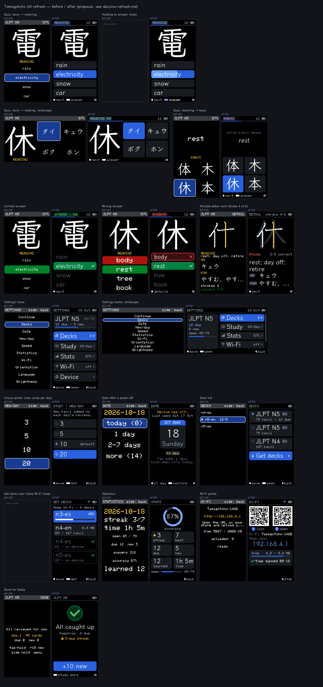

**Mockups.** `docs/ux/<screen>-{before,after}.png` are at native resolution,
and the `@3x` files are nearest-neighbour upscales. `docs/ux/overview.png` is
the contact sheet. They are generated, not drawn:

```sh
cd tools/pack-builder && uv run python ../ux-mockups/render.py   # [--cache DIR] [--out DIR]
uv run python ../ux-mockups/render.py --tokens                   # colour table of §2.2
```

The script needs the builder cache (Klee One and the KanjiVG zip, from
`uv run tangocho-pack fetch --klee-one`), and its output is deterministic. **Before**
images are line-by-line ports of the `draw*` functions in
`firmware/src/main.cpp`. They use the same geometry, the built-in 6×8 Font0
with all 8 rows, pack glyphs rendered by the builder's own `FontRenderer` at
the default sizes (96/40/18/20 px), the `Renderer` wrap/centre/ellipsis rules
and RGB565 + `blend565`. (Side note: the builder's `preview.py` draws only 7
of Font0's 8 rows, so it cuts descenders; the mockup script draws all 8.) In other words, they show what the device draws, not
an impression of it. **After** images implement this proposal with the same
primitives. The sample data are five N5 kanji. The QR codes in the Wi-Fi
mockup are illustrative patterns and do not scan.

---

## 1. Audit

### 1.1 Interaction model today

Front button = A (Select), side button = B (Next). A tap fires on release, and
a hold fires at 600 ms (`board::kHoldMs`). A hold suppresses the tap.

| screen | A tap | A hold | B tap | B hold |
|---|---|---|---|---|
| quiz (question) | next option | answer | next option | settings |
| quiz (revealed) | continue¹ | continue¹ | continue¹ | settings |
| detail card | next question | next question | next question | settings |
| done | +10 new | +10 new | +10 new | settings |
| settings / decks / choice / date / stats | move | activate | back | back |
| Wi-Fi | – | – | stop portal (back) | stop portal |

¹ A correct answer goes to the next card. A wrong one opens the detail card first.

Problems:

- **I1 – Hold-to-answer is invisible.** No screen says that hold answers, and
  nothing moves during the 600 ms. A new user taps through the options and
  never learns to commit. A slightly long tap answers by accident, with no
  warning before the threshold.
- **I2 – The side button changes meaning.** In the quiz B tap = A tap (next
  option), on the done screen it means "+10 new", and in menus any B press
  means back. The only on-screen hints are "side: back" (header text) and the
  done screen's "side hold: menu".
- **I3 – A correct answer costs an extra press.** Every card is navigation
  taps + a hold + a tap to continue, even when nothing needs reading after a
  correct answer.
- **I4 – Settings are discoverable only by accident** (side hold). No
  quiz screen mentions them.
- **I5 – Pickers forget the saved value.** The highlight starts on the saved
  value, but once it moves nothing marks which one is saved. A hold applies
  and returns without any confirmation.

### 1.2 Screen by screen

**Quiz, portrait** — [before](ux/quiz-meaning-before@3x.png) / [after](ux/quiz-meaning-after@3x.png)

- **Q1 – One long option shrinks all four to 6×8 px.** Options use Font0 2×
  only if *every* option fits `w-4 = 129` px (≤ 10 characters). "electricity"
  (11) drops the whole question to 1× (cap height 7 px ≈ 0.7 mm at ~240 ppi).
  Measured on the cached KANJIDIC2: 3 % of N5-en and 6 % of N4-es first
  glosses are longer than 10 characters, so roughly **10 % (N5-en) to 22 %
  (N4-es) of meaning questions** render at 1×.
- **Q2 – Unselected options have no container.** Their fill is `kBlack` on
  black, so the list reads as floating labels, and the focus box is the only
  shape on screen.
- **Q3 – The mode label is ambiguous.** "MEANING" (yellow 1×) sits between
  the kanji and the options, so it can read as a caption for the kanji. Reading
  questions never say whether on'yomi or kun'yomi is wanted; the user has to
  infer it from katakana vs hiragana.
- **Q4 – The header wastes its space.** It holds the static deck name and a
  text battery percentage, with no session progress, although
  `Queue::remaining()` exists.
- **Q5 – Yellow has no fixed meaning.** It is used for labels, the date, the
  URL, the current stroke, low battery and the done screen's day line.

**Quiz, landscape** — [before](ux/quiz-reading-landscape-before@3x.png) / [after](ux/quiz-reading-landscape-after@3x.png)
The two-column split works well. The mode label is squeezed under the kanji
at y = 124, and idle options are again invisible.

**Meaning → kanji** — [before](ux/quiz-kanji-before@3x.png) / [after](ux/quiz-kanji-after@3x.png)
The prompt "rest" floats in the kanji area, and the only clue to the question
is the 1× "KANJI" label.

**Answer feedback** — correct [before](ux/feedback-correct-before@3x.png) / [after](ux/feedback-correct-after@3x.png), wrong [before](ux/feedback-wrong-before@3x.png) / [after](ux/feedback-wrong-after@3x.png)

- **F1 – Colour alone signals the result.** The green (0,130,40) and red
  (170,20,20) fills have a luminance contrast of only **1.46:1**, so for
  protan/deutan users they are two similar dark tiles. No icon, shape or word
  tells them apart.
- **F2 – The grade is hidden.** A slow correct answer is graded Hard, but the
  user never sees Good/Hard/Again or the next interval.
- **F3 – Uninvolved options stay at full white.** Nothing guides the eye to
  the correct/wrong pair.

**Mistake detail card** — [before](ux/detail-before@3x.png) / [after](ux/detail-after@3x.png)

- **D1 – It never shows what you picked**, which is the reason the card opened.
- **D2 – Three faces compete.** Labels are yellow 1×, meanings are 1× because
  2× does not fit, and readings are 18 px. A fixed reserve forces the meanings
  onto one line.
- **D3 – The stroke animation hides the rest of the kanji.** Strokes after
  the current one are not drawn, so the final shape is not visible while it
  plays. There is no stroke counter, and every frame redraws the whole card.
- **D4 – No hint says that a tap continues.**

**Settings home** — portrait [before](ux/settings-home-before@3x.png) / [after](ux/settings-home-after@3x.png), landscape [before](ux/settings-home-landscape-before@3x.png) / [after](ux/settings-home-landscape-after@3x.png)

- **S1 – The rows are crowded and tiny.** Ten rows are forced onto one screen.
  In portrait the step is 21 px with 17 px boxes, so *every* label falls to
  Font0 1× (`labelFont` needs 22 px). In landscape the step is 11 px with 10 px
  boxes and 1 px gaps.
- **S2 – No current values.** New/day, Speed, Orientation, Language and
  Brightness each have to be opened to read their value.
- **S3 – A flat list with an opaque name and a redundant row.** "Continue"
  duplicates the side button, and "Speed" is really the Hard threshold. Study,
  device and connectivity settings are mixed, and every in-flight feature
  (Power off, Auto orientation, Get decks, time sync) would add more rows.
- **S4 – The labels are centred**, which makes a list slower to scan than
  left-aligned labels.

**Deck list** — [before](ux/decks-before@3x.png) / [after](ux/decks-after@3x.png)
It shows file names (`n5-en`) at 1× in 18 px rows. The loaded deck is marked
`*` with an unlabeled `12/5` (due/new), and the list has no way to get more
decks.

**Choice picker** — [before](ux/choice-before@3x.png) / [after](ux/choice-after@3x.png)
26 px of blank space sit under the header. The values are bare ("3"), with no
unit or explanation, and the saved value is not marked (I5).

**Date** — [before](ux/date-before@3x.png) / [after](ux/date-after@3x.png)
After a power-off the date screen appears at boot with no explanation. The
buckets hide what they do ("2-7 days" adds 4), and the date is ISO
`2026-10-18`. `feature/day-detection` replaces the buckets with a stepper
(tap +1 day, hold confirms); the after mockup styles that stepper.

**Statistics** — [before](ux/stats-before@3x.png) / [after](ux/stats-after@3x.png)
Eight centred lines each pick 2× or 1× by their own width, so three lines are
large and five small for no semantic reason. "streak 3/7" is ambiguous
(current/best), and the date is the most prominent item.

**Wi-Fi portal** — [before](ux/wifi-before@3x.png) / [after](ux/wifi-after@3x.png)

- **W1 – The instructions are cut off in portrait.** "Open the URL on your
  phone and upload a..." loses ".tgc", because 44 characters do not fit 2
  lines × 21 characters at 1×.
- **W2 – The URL is tiny.** The one thing the user must type is 1×, and the
  storage line shows raw KB. A QR code would avoid typing altogether
  (LovyanGFX has `qrcode()`).

**Done** — [before](ux/done-before@3x.png) / [after](ux/done-after@3x.png)
"day 1  45 cards" exposes the internal SRS day index and the record count. The
actions are prose ("tap/hold: +10 new", "side hold: menu"), and the centred
block leaves the top 40 % empty. This screen is the only one with hints, and
they use a different style from everything else.

**Error and boot states** (not mocked). `showError` uses a red header and
`println` wrapping (mid-word) in 1×. The texts are developer-facing ("Run: pio
run -t uploadfs"). An end user needs one line saying what happened and one
action, such as "Re-flash from the release page" or "Hold side: Wi-Fi upload".

**Cross-cutting.**

- **X1 – Face is chosen by width, not role.** Each string picks Font0 1×,
  Font0 2× or a pack set by whether it fits, so the same role renders at
  different sizes on different screens and even on different questions.
- **X2 – Row geometry varies by screen.** Radii are 4/5, margins 1/2 px, row
  heights range from 10 to 32 px, and the focus outline is only sometimes
  drawn.
- **X3 – No motion or emphasis.** Every change is an instant full redraw,
  which is good for speed, but nothing marks the important moments: committing
  an answer and its result.

### 1.3 Top findings (ranked)

1. Hold-to-answer and the side button are undiscoverable, with no feedback
   during the hold (I1, I2, I4).
2. Correct/wrong feedback relies on red vs green (1.46:1 luminance) and hides
   the grade and interval (F1, F2).
3. Meaning options drop to 6×8 px whenever one option has more than 10
   characters (~10–22 % of questions) (Q1).
4. The 10-row settings home is unreadable: every label is 1× in portrait and
   rows are 10 px tall in landscape. It shows no values and it will keep
   growing (S1–S3).
5. Idle options and rows have no container, so the screens read as floating
   text (Q2, X2).
6. The detail card does not show your mistake, and the stroke animation hides
   the rest of the kanji (D1, D3).
7. Type sizes follow string width instead of role, and yellow is overloaded
   (X1, Q5).
8. The Wi-Fi screen truncates its own instructions and makes the user type the
   URL at 1× (W1, W2).

---

## 2. Design system

Principles: **one role, one style** (a role never changes size because of its
text); **flat fills under text** (the 4bpp glyph blend mixes against the flat
`bg` passed in, so anti-aliased text must sit on a solid colour); **colour
plus shape** for every state; and **cheap motion only where input happens**.

### 2.1 Layout grid

Base unit 4 px: gutter 4, gap 4, tile radius 4, pill radius 3.

| element | portrait 135×240 | landscape 240×135 | T-Display 170×320 |
|---|---|---|---|
| header (incl. 2 px progress or 1 px hairline) | y 0–15 | y 0–15 | y 0–15 |
| prompt (kanji em 96) | y 16–117, full width | x 0–99 | y 16–117 (or `--large-px 128`) |
| answers | y 120–223, 4 × 23 px + 3 gaps | x 104–235, 2×2 or 4 rows of 22 | y 120–303, 4 × 43 px |
| hint bar | y 228–239 | y 123–134 | y 308–319 |
| list row (1 line / 2 lines) | 26 / 36 | 22 / 32 | 30 / 40 |

When the hint bar is hidden (§2.5), the answer tiles grow to 26 px. Lists
scroll instead of shrinking: a `ListView` keeps the focus visible and shows a
2 px scroll thumb. That is the main structural change from today's "fit every
row" loops.

### 2.2 Colour tokens

All values are RGB565-exact; "RGB" is what the panel shows after bit
replication. Generated with `render.py --tokens`.

| token | RGB565 | RGB | on bg | white on it | role |
|---|---|---|---|---|---|
| `bg` | `0x0000` | `#000000` | 1.0 | 21.0 | background; blend background for glyphs |
| `surface` | `0x18E4` | `#181C21` | 1.2 | 17.1 | idle tile / row |
| `surface-hi` | `0x2967` | `#292C39` | 1.5 | 13.9 | pills, progress track |
| `line` | `0x3A0A` | `#394152` | 2.1 | 10.2 | hairlines, outlines |
| `ghost` | `0x2988` | `#293042` | 1.6 | 13.2 | unwritten strokes on the detail card |
| `text` | `0xFFFF` | `#FFFFFF` | 21.0 | – | primary text, kanji |
| `text-dim` | `0xA577` | `#A5AEBD` | 9.4 | – | titles, secondary values, hint labels |
| `text-faint` | `0x636F` | `#636D7B` | 4.0 | – | de-emphasised (dimmed options after reveal) |
| `accent` | `0x2B1B` | `#2961DE` | 3.9 | 5.4 | focus fill |
| `accent-press` | `0x64FF` | `#639EFF` | 7.9 | 2.7 | hold-progress fill (transient) |
| `accent-hi` | `0x7D5F` | `#7BAAFF` | 9.0 | – | accent text/icons on black; meaning mode |
| `ok` | `0x0408` | `#008242` | 4.3 | 4.9 | correct tile |
| `ok-hi` | `0x5EF1` | `#5ADF8C` | 12.4 | – | correct text/icons on black |
| `ok-bg` | `0x0183` | `#003018` | 1.4 | 14.6 | correct result pill |
| `err` | `0xC945` | `#CE2829` | 4.0 | 5.3 | wrong-tile outline (2 px) |
| `err-hi` | `0xFB6D` | `#FF6D6B` | 7.7 | – | wrong text/icons on black |
| `err-bg` | `0x3882` | `#391010` | 1.3 | 16.7 | wrong-tile fill, wrong result pill |
| `warn` | `0xFE26` | `#FFC731` | 13.5 | – | current stroke, low battery, date notice, Hard |
| `mode-reading` | `0x6EF9` | `#6BDFCE` | 13.1 | – | reading-mode pill |
| `mode-kanji` | `0xCD1F` | `#CEA2FF` | 10.2 | – | kanji-mode pill |

Contrast notes. The main text pairs are white on `accent` 5.4:1, white on `ok`
4.9:1 and `text-dim` on `surface` 7.7:1, all at or above WCAG AA (4.5:1).
`text-faint` (4.0:1) is reserved for de-emphasised or disabled content, and
`accent-press` (2.7:1 with white) appears for under 0.6 s, while the user is
already committing. Correct vs wrong now differ in **shape** (filled + ✓ vs
dark fill + 2 px outline + ✗ + "AGAIN" pill) and in luminance (`ok` vs
`err-bg` 3.4:1, up from 1.46:1). Yellow is reserved for `warn`.

The tokens are `constexpr` in a new `ui/Theme.h`. The firmware currently
builds `kGrey`/`kHighlight`/… with `color565()` at runtime in `setup()`.

### 2.3 Type scale

| role | face | size | used for | availability |
|---|---|---|---|---|
| Display | pack set 0 | `large_px` (96) | prompt kanji, detail kanji | today |
| Kanji option | pack set 1 | `small_px` (40) | meaning→kanji tiles | today |
| Kana option | pack set 3 | `option_px` (20) | reading tiles | today |
| **Label** | 18 px proportional | 18 px, 20 px pitch | answer text, row labels, values, detail text | U1 / U2 / U3 (below) |
| **Caption** | Font0 1× (6×8) | 8 px | header, hint bar, pills, metadata (uppercase for titles/pills) | today |
| **Numeral** | 32 px digits | 32 px | date day, (stats hero) | U3 only; stand-in: Font0 3× |

Font0 2× is retired: it was the blocky middle size that caused X1. It stays
only as the U1 fallback below. The Label
role is drawn by a new `Renderer::drawLabel` that centres on the **cap height**
instead of the font's line box (Klee One 18 px has a 27 px line box, which
does not fit a 23 px tile). Single-script lines use a 20 px pitch instead of
27 px.

Where the 18 px Label face comes from, in increasing scope:

- **U1 – today, no format change.** Pack set 2 is the builder's 18 px text set,
  and it always contains ASCII (`build.py` adds U+0020–U+007E). English UI
  strings can use it now. Spanish UI strings need á é í ó ú ñ ¿ ¡, which set 2
  only has if the deck's own strings contain them. A per-screen
  `packCanDraw()` check falls back to Font0 2×, and Font0 is the only option
  before a pack is loaded (Wi-Fi boot, errors).
- **U2 – builder guarantee, spec first.** The builder always adds Latin-1
  (U+00A0–U+00FF) plus `· … › – —` to set 2: about 100 glyphs, roughly
  10 KB/pack. This changes what the contract promises, not the binary layout,
  so `docs/pack-format.md` gets a sentence ("set 2 always covers …") **before**
  the builder change. Old packs keep the U1 fallback.
- **U3 – firmware UI font (recommended).** A generator script (reusing
  `FontRenderer`) emits `firmware/src/ui/UiFont.h`: Latin-1 at 18 px plus
  digits/`%:/+-` at 32 px, in the same 4bpp glyph format, for roughly
  20–30 KB of flash (the app is ~1.2 MB of its 2 MB slot). It works with no
  pack loaded and does not depend on `--text-px`. **No pack-format change.**
  The typeface is open: Klee One matches the kanji, a sans (Noto Sans or
  M PLUS 1p, OFL) reads more "modern". Either way it must be added to
  `docs/data-sources.md`.

LovyanGFX's own proportional fonts (FreeSans*, DejaVu*, Font2/Font4) were
checked and are ASCII-only (`DejaVu12` covers 0x20–0x7E), so they cannot draw
Spanish UI text. The mockups draw the Label and Numeral roles with Klee One
SemiBold at 18/32 px, which is exactly U1/U2 for 18 px and U3 for 32 px.

Small, no-risk addition: map U+00B7 `·` → 0xF9, U+2022 `•` → 0x07 and U+00B0
`°` → 0xF8 in `render/GlcdCp437.h`. Font0 already has these glyphs, and the
mockups use `·` as the separator in metadata. 0xF9 is CP437's 2×2 `∙`, which
reads better at 1× than 0xFA's 2×1 `·`.

### 2.4 Components

All components live in a new `ui/Widgets.{h,cpp}` and are drawn into the
sprite canvas.

- **Header / status bar** (16 px). Left side: a title in `text-dim` caption,
  **or** a pill. In the quiz the pill is the mode (`MEANING`,
  `READING ON`/`KUN`, `KANJI`) in its mode colour, and on reveal it becomes the
  result (`✓ GOOD · 4d`, `✓ HARD · 2d`, `✗ AGAIN`). Right side: an optional
  value (cards left, date) and a 13×7 battery icon (`warn` < 20 %, `err-hi`
  < 10 %). The bottom 2 px is session progress in the quiz (answered /
  (answered + `Queue::remaining()`)); other screens get a 1 px `line` hairline
  there instead. The deck name moves out of the quiz header into the settings
  summary.
- **Hint bar** (12 px, bottom). Front-button actions sit on the left as icon +
  word: **• = tap, ▬ = hold** (a short and a long mark, as in Morse). The side
  button's action is right-aligned as an icon (**◂** back, **≡** settings),
  optionally with a word. While a hold is in progress, the ▬ item lights up.
  Budget: about 20 characters in total. Spanish `• mover ▬ abrir ◂ atrás`
  fits portrait with 2 px to spare.
- **Option tile.** States: *idle* (`surface`), *focus* (`accent`), *holding*
  (`accent-press` filling left→right), *correct* (`ok` + ✓), *wrong* (`err-bg`
  + 2 px `err` + ✗), *dimmed* (no fill, `text-faint`). Labels are
  left-aligned with 8 px padding, and the right 20 px is kept free for the ✓/✗.
- **List row.** `surface`, or `accent` when focused. Optional 9×9 icon or
  radio, left-aligned Label, right-aligned caption value, chevron `›` when it
  opens a sub-screen. Two-line variant (36 px): Label + caption metadata
  (deck: `79 kanji · 12 due`, catalog: `ES · 367 kanji` + size).
- **Pill** (11 px): a caption on `surface-hi`, used for the mode, the result,
  `ON`/`KUN` tags, the language `EN`/`ES` and `+1 day`.
- **Progress bar**: 2 px (header) or 3–4 px (deck coverage, download, free
  space) on `surface-hi`.
- **Summary card** (settings home): deck name, `12 due · 5 new` and a
  coverage bar (seen/total).
- **Calendar tile** (date stepper): an `accent` month band, the Numeral day
  and the weekday.
- **Icons**: 1bpp, 5–11 px, defined in a new `ui/Icons.h` and drawn with the
  existing `tgc::drawBitmap1bpp`. The set is check, cross, chevron, back,
  tap, hold, menu, wifi, plus, down, radio on/off, cards, book, chart, gear and
  flame (the shapes are in `render.py` `ICONS`).

### 2.5 Interaction additions

- **Hold progress.** 120 ms after the front button goes down on a focused
  tile or row, the tile starts filling with `accent-press` and is full at
  600 ms, when the hold fires. Releasing earlier is a tap and the fill
  disappears. This answers "tap or hold?" without any text, and it works the
  same in menus.
- **Hint bar policy (proposed).** The bar is always shown on menus. In the quiz
  it shows until the user has 50 lifetime answers (`Stats.answers`), and
  afterwards only after 8 s idle on a question. Hiding it gives the space back
  to the tiles.
- **Auto-advance after a correct answer (proposed, setting).** On a correct
  reveal, a 700 ms countdown runs in the hint bar and the next card follows; any
  press skips the wait. Wrong answers never auto-advance (detail card).
- **Saved vs focused** in pickers: a radio marks the saved value, and the
  `accent` fill marks the focus.
- **On/kun stated** in the mode pill (`READING ON` / `READING KUN`), since
  `Question::readingKind` is already known.

### 2.6 Motion and frame cost

Measured from the libraries: the StickS3 panel runs on SPI3 at **40 MHz**
(M5GFX `freq_write = 40000000`), i.e. 0.2 µs/byte, so a **full 135×240 frame
is 64.8 KB ≈ 13 ms on the wire**. The T-Display-S3 uses i80 8-bit at 20 MHz,
so 108.8 KB ≈ 5.4 ms. **Region pushes are possible**: LovyanGFX
`pushImage` clips to the destination's clip rect and sends only the clipped
window (`LGFXBase::pushImage`). That makes `display.setClipRect(r);
canvas.pushSprite(0,0); display.clearClipRect();` a partial update. Render
time at 80 MHz is **not measured yet**. Assuming about 1 µs per blended glyph
pixel through `drawPixel`, a full quiz frame is roughly 5–12 ms to render plus
13 ms to push.

| motion | frames | per frame (push) | notes |
|---|---|---|---|
| hold-progress fill | ~12 over 480 ms | tile 127×23 = 5.8 KB → 1.2 ms + label | label drawn twice with `setClipRect` so its AA blends against each fill |
| reveal | 1 | full frame, as today | instant; the emphasis comes from state colours/icons, not delay |
| auto-advance countdown | ~14 over 700 ms | hint bar 135×12 = 3.2 KB → 0.7 ms | optional |
| kanji fade-in on a new card | 3 over ~120 ms | 96×96 = 18 KB → 3.7 ms | fg stepped 33/66/100 % (the blend already takes fg) |
| stroke order | 1 per 550 ms | kanji box only (18 KB) | today it redraws the whole card |
| screen slide (enter/back) | ~5 | 64.8 KB → 13 ms | optional, last phase, two PSRAM sprites; probably not worth the battery |

Rules: no animation blocks input, and any press cancels it. Apart from the
hold fill and the countdown, no motion lasts more than 150 ms. While idle,
only the stroke order animates, and it stops once the panel dims.

### 2.7 Accessibility

- Contrast as in §2.2; essential information never uses `text-faint`, and no
  essential line is 1 px wide.
- State is never shown by colour alone (✓/✗ icons, outline vs fill, result
  word).
- Answers and actionable labels use the 18 px Label face or larger. The 6×8
  caption is for status and metadata only.
- Outdoors: black background and white text, with the brightness setting
  unchanged. Legibility of 6×8 vs 18 px is checked in sunlight in Phase 1
  (§4).
- Motor: the 600 ms hold is fixed today. A Short/Normal/Long hold setting
  (400/600/900 ms) is cheap once hold progress exists (decision 6.7).
- Localisation: hint bar and pill strings have a pixel budget, documented
  next to `UiStrings`.

---

## 3. Settings home regrouped

Ten flat rows become **five groups** plus a summary card. "Continue" goes,
because the side button already means back. The rule from now on: **new
settings go into a group, never onto the home.**

```
Settings                     header: "SETTINGS" · date · battery
│  [summary] JLPT N5   45/79 · 12 due · 5 new · coverage bar
├─ Decks ›            3      deck list: name + EN/ES pill + "79 kanji · 12 due", radio = loaded
│   └─ ⇣ Get decks ›         home Wi-Fi catalog → download list   (feature/home-wifi-decks)
├─ Study ›            10/day
│   ├─ New per day           3 / 5 / 10 (default) / 20
│   ├─ Hard after            1.5 / 3 (default) / 5 s / off        (was "Speed")
│   └─ Date ›                stepper: tap +1 day, hold confirm    (feature/day-detection)
├─ Stats ›            87%    accuracy ring + tiles
├─ Wi-Fi ›            off    portal: QR join + QR URL, uploads, "time synced" from the phone
│                            (POST /time, feature/day-detection)
└─ Device ›
    ├─ Orientation           Portrait / Landscape / Auto          (Auto = IMU, StickS3 only; feature/imu-rotation)
    ├─ Brightness            12 / 25 / 50 / 100 %
    ├─ Language              Auto / English / Español
    ├─ Sleep now             save + deep sleep                    (feature/power-button)
    └─ About ›               version, licences: KANJIDIC2 CC BY-SA 4.0, KanjiVG CC BY-SA 3.0, Klee One OFL
```

- Portrait shows all five rows at 26 px with the 18 px Label face. Landscape
  puts the summary in a left column and the rows on the right (4 visible, the
  list scrolls).
- **About** closes the open "attribution line on the device itself" item from
  the roadmap's "Before publishing" section.
- The date also appears in the home header, so a wrong date is noticed without
  opening Study › Date.
- Implementation: `menuRows[10]` + the `switch` in `activateSetting()` become
  small tables (`MenuItem { label, icon, valueFn, action }`) per group with a
  one-level group stack. The four in-flight branches all edit
  `activateSetting()`/`menuRows`, so this lands **after** them or is
  coordinated (§4, Phase 3).
- **Status of `Wi-Fi ›` (2026-10-18, `feature/portal-home-wifi`).** Implemented
  ahead of the rest of Phase 3, because the portal needed it: the single
  settings row became **"Wi-Fi »"** (Font0 has `»`, not `›`), a submenu with
  **Web portal** (home mode over the saved home network, else setup mode),
  **Home: <network>** (a connection test), **Setup mode** (the open access
  point) and **Forget network** (a Cancel/Forget picker). The settings home
  keeps its 11 flat rows; the submenu is the first group. The portal screen has
  the **QR codes**: in setup mode one that joins the access point
  (`WIFI:T:nopass;S:<ssid>;;`, escaped) and, on a tap, one that opens the page;
  in home mode one of `http://<ip>/`; free space in MB. Not done yet: the
  row's "off" value, the "time synced" line, the group-table refactor and the
  design-system styling (it uses today's `drawRow()` and 1x text). See
  docs/decisions.md, "Portal over the home Wi-Fi; task-oriented page; Wi-Fi
  menu".

---

## 4. Phased implementation plan

Effort is in focused working days. Each phase builds on its own and keeps
portrait/landscape working.

**Phase 1 – Foundations (S–M, 1–2 d, low risk).**
- `ui/Theme.h` (constexpr tokens, spacing), `ui/Icons.h` (1bpp icons).
- `GlcdCp437.h`: map `·` `•` `°`, plus a native test.
- `Renderer::drawLabel()` (cap-height centring, one line, ellipsis) and
  `Renderer::packCanDraw()`.
- `ui/Widgets.{h,cpp}`: `drawHeader`, `drawHintBar`, `drawTile`, `drawRow`,
  `drawPill`, `drawProgress`, and a `ListView` (items, focus, first visible,
  row height, scroll thumb). They replace the loops in `drawMenu`,
  `drawDecks`, `drawChoice` and `drawDate`.
- `presentRegion(x,y,w,h)` built on `setClipRect` + `pushSprite`.
- Timing: under `TGC_QUIZ_LOG`, log `micros()` around each `draw*` and
  `present()`.

**Phase 2 – Quiz, feedback, detail (M, ~2 d, medium risk: input loop).**
- `drawQuiz`: new header (mode pill, remaining, battery, progress), tiles with
  containers, meaning options in the Label face (U1 now), the hint bar and its
  policy.
- Reveal: tile states, ✓/✗, result pill (Good/Hard/Again + interval from
  `Record.dueDay - today`, already logged in `holdAction`).
- Hold progress in `loop()`: while `keyA.down` and `t - keyA.downAt >= 120`,
  redraw the focused tile every ~40 ms with `presentRegion`. Grading still uses
  `keyA.downAt`, so it is unchanged.
- `drawDetail`: picked option, ghost kanji + stroke counter, `ON`/`KUN` pills,
  and an animation redraw limited to the kanji box.

**Phase 3 – Settings and secondary screens (M, ~2–3 d, medium risk: merge
conflicts).**
- The §3 tree with group tables, row values, the summary card, picker radios
  and one-line descriptions.
- Deck list from pack headers: deck name, lang and card count, from a 64-byte
  header read per file.
- The "Get decks" row and screen styling, built on `feature/home-wifi-decks`.
- Date stepper styling, built on `feature/day-detection`.
- Stats tiles + ring (`fillArc`), done screen, error screens rewritten for end
  users.
- Wi-Fi: QR codes (`qrcode()`; join = `WIFI:T:nopass;S:<ssid>;;`), a fixed
  instruction text and MB units. *(QR codes, MB units and the Wi-Fi submenu
  done on `feature/portal-home-wifi`, see §3.)*
- New `UiStrings` entries in en/es, and `menuRows[10]` removed.

**Phase 4 – Typography (M, 1–2 d; needs decision 6.2).**
- U3: `tools/ui-font/` generator → `ui/UiFont.h`, and the Renderer gains a font
  source for the UI set. Alternatively U2: the spec sentence in
  `docs/pack-format.md` first, then `build_pack` adds Latin-1 to set 2, with
  tests.
- Retire Font0 2×.

**Phase 5 – Motion polish (S–M, 1 d, optional).**
- Kanji fade-in, the auto-advance setting, and (maybe) slides behind an
  "Animations" setting.

**Measure on hardware** (StickS3 first, then the T-Display-S3):

- **Frame time.** Render + push per screen. Targets: hold-fill frame ≤ 20 ms,
  full redraw ≤ 40 ms, tap → highlight ≤ 50 ms.
- **Legibility outdoors.** In direct sun at 30–40 cm, at brightness 50 % and
  100 %: is a 6×8 caption readable, and is an 18 px option?
- **Battery.** Current draw while the quiz idles and during hold/stroke
  animation (the dim/sleep policy is unchanged).
- **First use.** Can someone who never saw the device answer the first card
  and find settings with no explanation? Count presses per card before and
  after (auto-advance).

---

## 5. Mockup index

| screen | before | after |
|---|---|---|
| quiz, kanji → meaning | 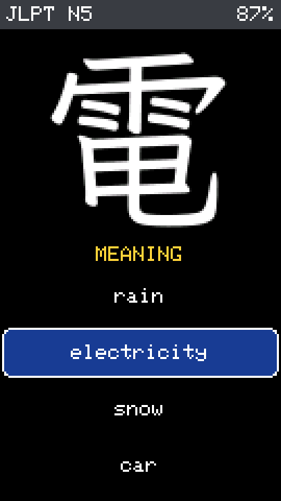 | 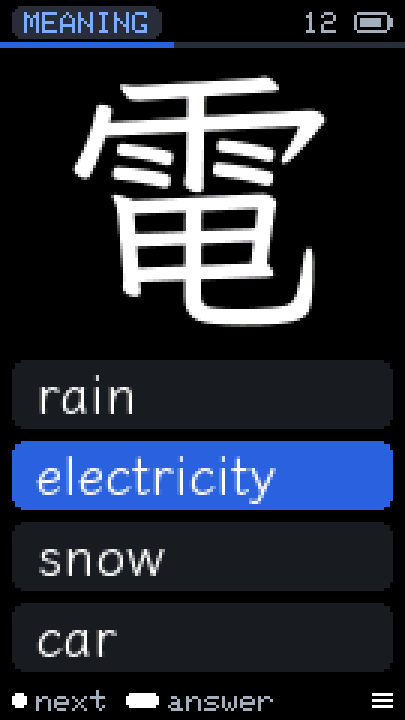 |
| holding to answer | – (new) | 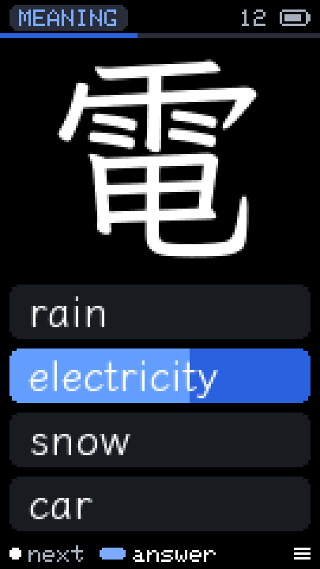 |
| quiz, reading, landscape | 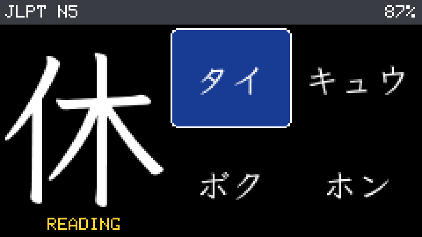 | 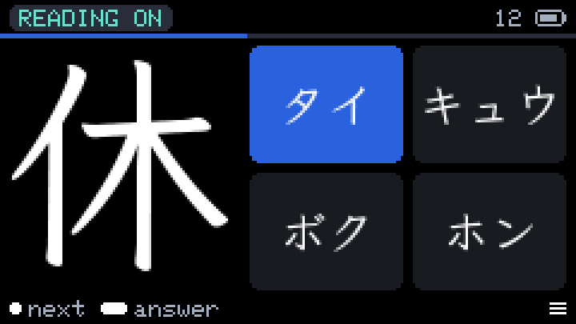 |
| quiz, meaning → kanji | 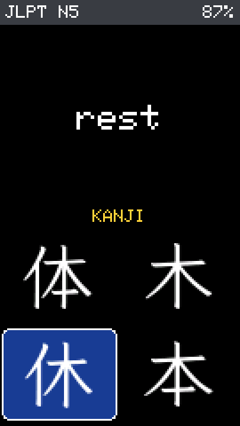 | 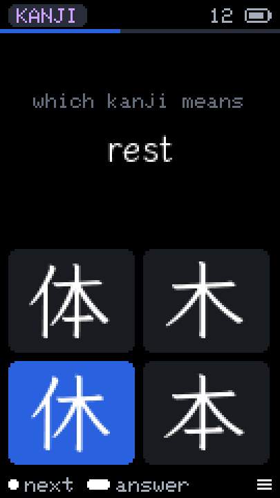 |
| correct | 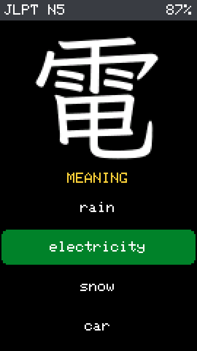 | 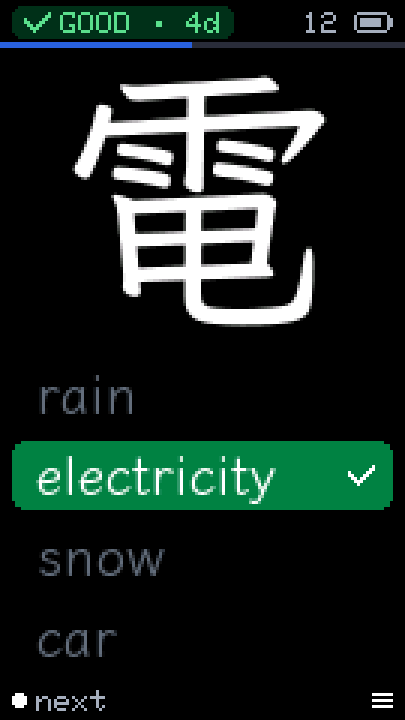 |
| wrong | 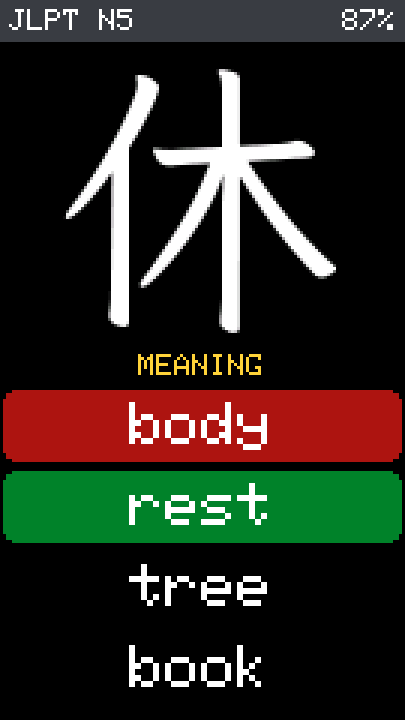 | 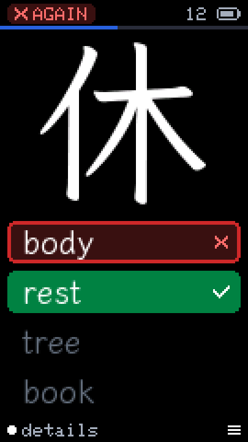 |
| detail card (stroke 4/6) | 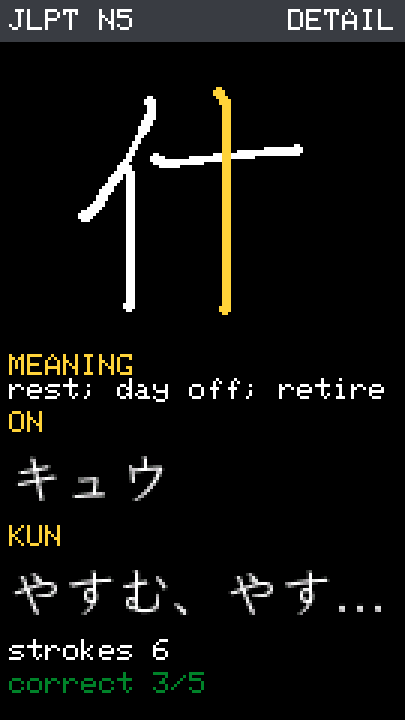 | 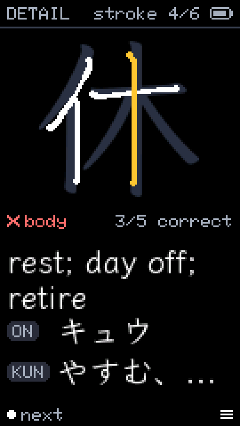 |
| settings home | 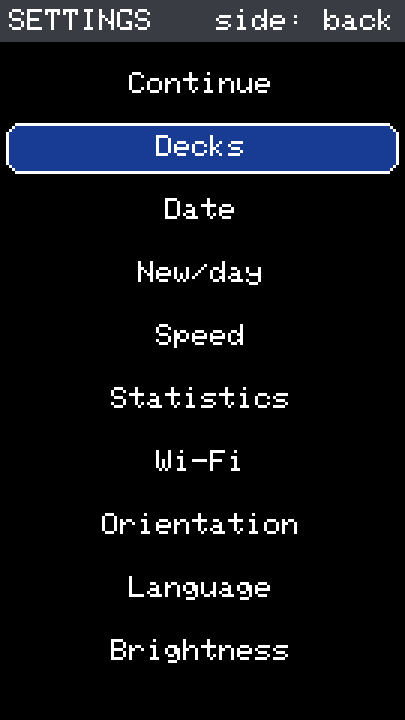 | 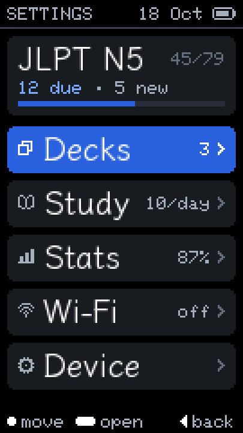 |
| settings home, landscape | 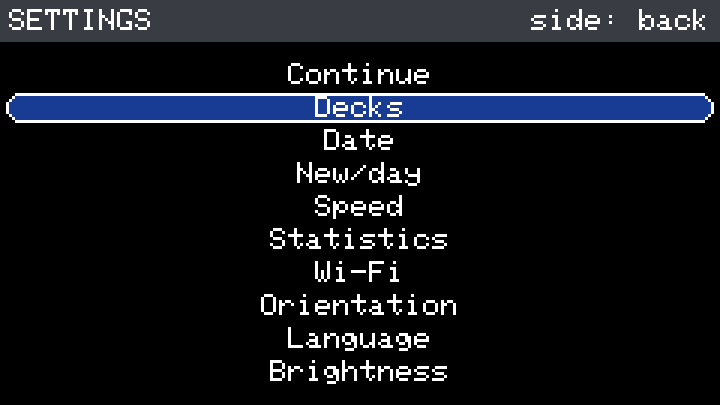 | 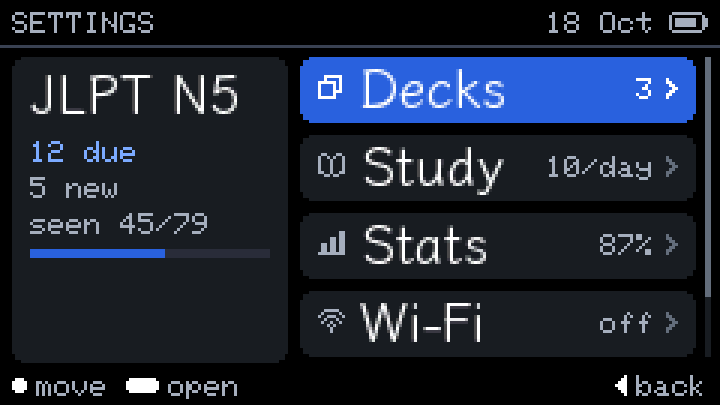 |
| choice picker | 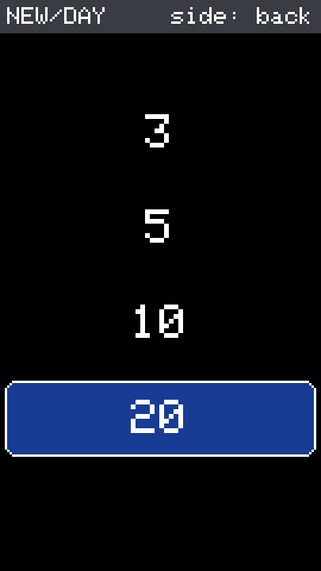 | 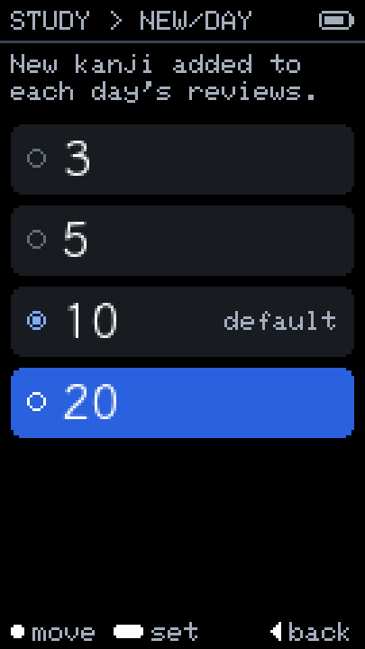 |
| date | 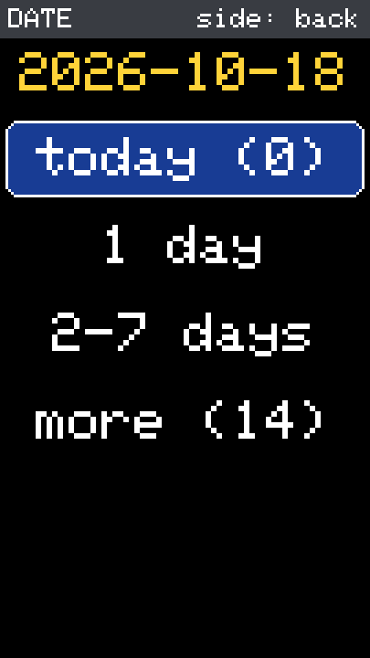 | 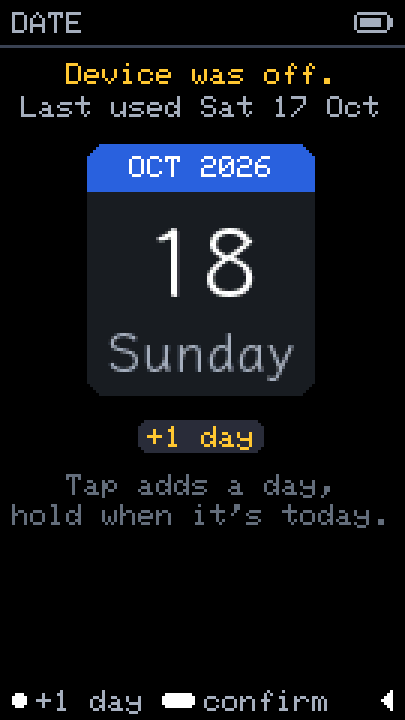 |
| deck list | 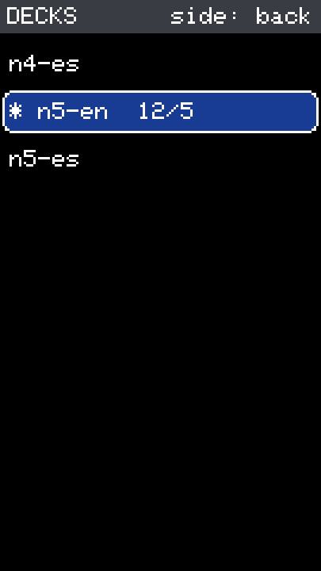 | 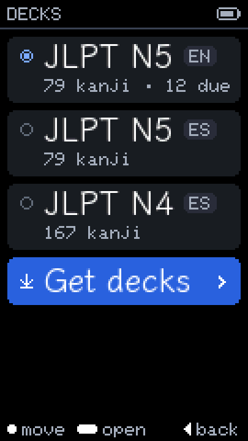 |
| get decks | – (new) | 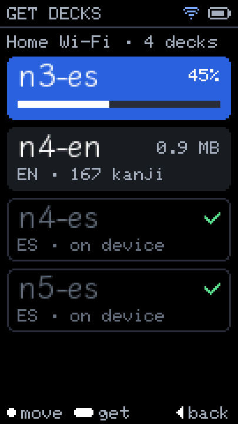 |
| statistics | 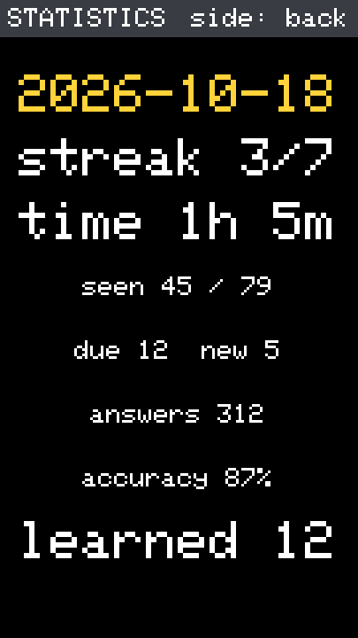 | 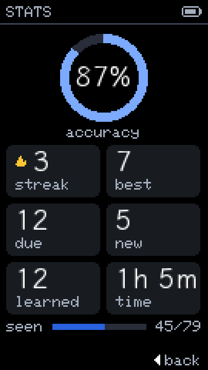 |
| Wi-Fi portal | 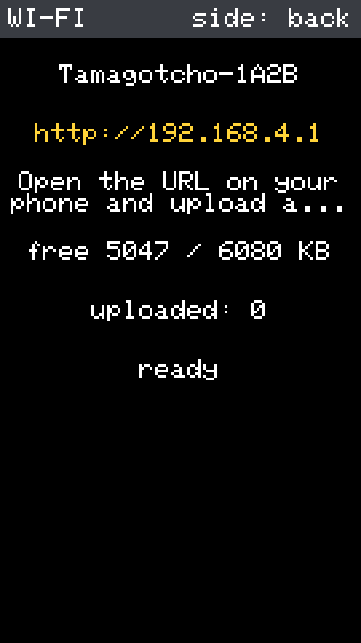 | 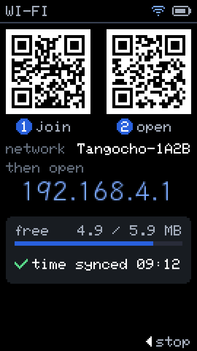 |
| done | 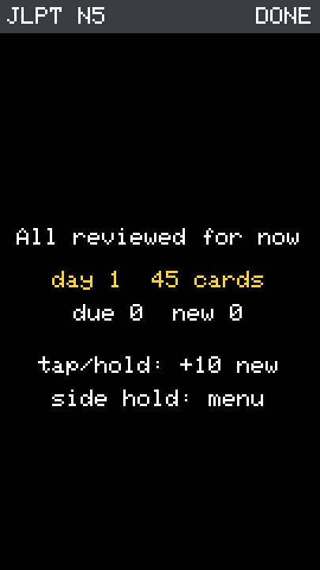 | 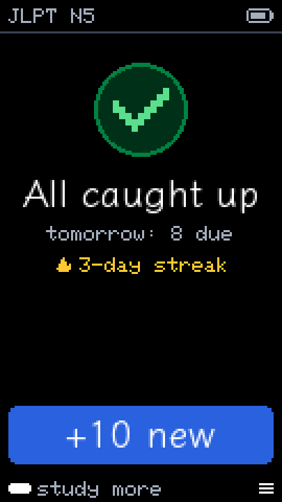 |

---

## 6. Decisions needed

1. **Direction.** Approve the tokens, tile states, header pill and hint bar
   (§2), or say what to change.
2. **Typography.** U1 only, U2 (builder guarantees Latin-1 in set 2; spec
   change), or U3 (firmware UI font; recommended)? And which typeface: Klee
   One or a sans?
3. **Auto-advance** after a correct answer: offer it, its default (on/off) and
   its delay.
4. **Quiz header.** Should the mode pill + session progress replace the deck
   name?
5. **Hint bar policy.** Always, first 50 answers + idle, or never in the quiz?
6. **Settings tree and names.** The five groups, "Hard after" instead of
   "Speed", Stats at the top level.
7. **Hold duration setting** (400/600/900 ms), and whether the side tap in the
   quiz stays "next option" (recommended: keep) or becomes something else.
8. **Catalog deck names.** The catalog line (`name lang cards bytes sha256
   url`) has no human deck name, so "Get decks" shows file names (`n3-es`).
   Adding a column is a catalog-format change (spec first).
9. **Landing order.** After the four in-flight branches (power button, day
   detection, home Wi-Fi decks, IMU rotation), or coordinated with them?
10. **QR codes** on the Wi-Fi screen (Wi-Fi join + URL). *(Done on
    `feature/portal-home-wifi`: join + URL in setup mode, URL in home mode.)*
